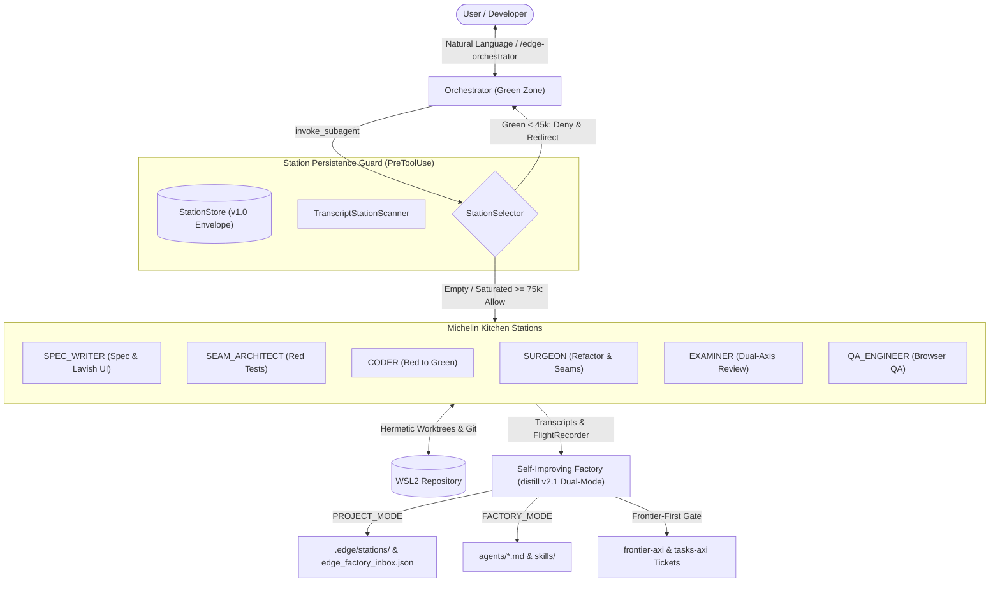

# 🏛️ Edge Architecture — Deterministic Agent Harness & Michelin Brigade

> **"Own your control flow. Small, focused agents. Stateless reducers with deterministic transition gates. The model must never decide its own transitions; transitions are governed 100% by OS process exit codes."**  
> — *Dexter Horthy (12-Factor Agents)* & *Lauren Tan / Poteto (Brigade de Cuisine)*

Edge is a deterministic codebase health, architectural quality gate, and autonomous refactoring suite engineered as a plugin for **Google Antigravity**. It elevates AI coding from a stochastic, error-prone chatbot loop into a disciplined, multi-station engineering organization.

---

## 📑 Table of Contents
1. [Core Architectural Doctrines](#1-core-architectural-doctrines)
2. [The Michelin Kitchen Brigade (Brigade de Cuisine)](#2-the-michelin-kitchen-brigade-brigade-de-cuisine)
3. [The Orchestrator & Green-Zone Protection](#3-the-orchestrator--green-zone-protection)
4. [Antigraveyard Station Persistence & Rotation Engine](#4-antigraveyard-station-persistence--rotation-engine)
5. [The Zero-Handoff Invariant](#5-the-zero-handoff-invariant)
6. [AXI-First Tool Hierarchy & Fallback Protocol](#6-axi-first-tool-hierarchy--fallback-protocol)
7. [Deterministic Quality Gates & Hook Architecture](#7-deterministic-quality-gates--hook-architecture)
8. [End-to-End System Architecture Diagram](#8-end-to-end-system-architecture-diagram)
9. [Directory Structure](#9-directory-structure)

---

## 1. Core Architectural Doctrines

Edge enforces four unshakeable operational invariants across all workflows:

* 🐧 **WSL2-First Execution Invariant (Rule 0):**  
  All code execution, git operations, and test runs operate exclusively inside the Linux WSL2 subsystem (`/home/oguz/...`). Windows runtimes are never assumed.
* 🛡️ **Test Immutability Invariant:**  
  When resolving bugs or implementing features, tests written by the `SEAM_ARCHITECT` are strictly immutable. The `CODER` cannot weaken assertions, mock away problems, or delete failing tests to turn them green.
* 🍽️ **Michelin Station Specialization:**  
  *"Tatlıcı sadece tatlı yapar, çorbacı sadece çorba yapar."* Agents do not act as disposable generalists. Each station worker is a persistent specialist with immutable tool boundaries and domain contracts.
* 🚫 **Zero-Handoff Rotation Invariant:**  
  When an agent's context window reaches cognitive exhaustion ($\ge 75\text{k}$ tokens, RED zone), it is cleanly retired. No slow, lossy LLM summarization or handoff compaction is performed; every work package is self-contained and hermetic.

---

## 2. The Michelin Kitchen Brigade (Brigade de Cuisine)

Instead of spawning ephemeral subagents that attempt to solve entire problems in a single noisy prompt, Edge partitions engineering responsibilities across **7 Canonical Stations** with deterministic merge delivery:

```
                  ┌───────────────────────────────────────────────────────────────┐
                  │          DETERMINISTIC FSM DELIVERY (brigade finish-slice)    │
                  └───────────────────────────────┬───────────────────────────────┘
                                                  │
                  ┌───────────────────────────────┴───────────────────────────────┐
                  ▼                                                               ▼
        [ TRACK: FEATURE ]                                              [ TRACK: REFACTOR ]
  ┌───────────────────────────────┐                               ┌───────────────────────────────┐
  │ SPEC_WRITER (lavish-axi Gate) │                               │ SURGEON (Chef de Partie)      │
  │ RESEARCHER (Root Cause / RCA) │                               │ Architecture & Decoupling     │
  │ SEAM_ARCHITECT (Red Tests)    │                               │ Pure Core Extraction          │
  │ CODER (Turns Red to Green)    │                               └───────────────┬───────────────┘
  └───────────────┬───────────────┘                                               │
                  └───────────────────────────────┬───────────────────────────────┘
                                                  ▼
                                  ┌───────────────────────────────┐
                                  │ EXAMINER (Sous / Maitre d')   │
                                  │ Dual-Axis Standards & Spec    │
                                  └───────────────┬───────────────┘
                                                  ▼
                                  ┌───────────────────────────────┐
                                  │ QA_ENGINEER (Sommelier)       │
                                  │ E2E Browser & Visual Parity   │
                                  └───────────────┬───────────────┘
                                                  ▼
                                  ┌───────────────────────────────┐
                                  │ Deterministic Merge & PR      │
                                  │ (brigade finish-slice)        │
                                  └───────────────────────────────┘
```

### The 7 Stations Breakdown

| Station | Metaphor | Responsibilities | Constraints |
| :--- | :--- | :--- | :--- |
| **`SPEC_WRITER`** | *Menu Planner* | INVEST vertical slicing (DB $\rightarrow$ Core $\rightarrow$ API $\rightarrow$ UI). Interactive HTML prototypes via `lavish-axi`. | Zero production code edits; human must seal UI approval. |
| **`RESEARCHER`** | *Scout* | AST tracing, dependency analysis, root-cause investigation. | Strictly read-only; delivers actionable seam findings. |
| **`SEAM_ARCHITECT`** | *Seam Engineer* | Michael Feathers seams, characterization tests, RED unit/contract tests. | Authors tests only; never implements the solution. |
| **`CODER`** | *Line Cook* | Implements production code to turn red tests GREEN. | Cannot alter or loosen test assertions (Test Immutability). |
| **`SURGEON`** | *Chef de Partie* | Core architecture refactoring, separating controllers from repositories. | Target contraction $\Delta\text{SLOC} < 0$; 100% test greenness. |
| **`EXAMINER`** | *Sous Chef / Maître d'* | Unified dual-axis review: `coding_standards.md`/Fowler smells and architectural invariants/scope-creep. | Strictly read-only; differentiates hard breaches from subjective nits. |
| **`QA_ENGINEER`** | *Sommelier* | End-to-end browser verification via `chrome-devtools-axi`. | Zero production code mutation; parks defects to `frontier-axi`. |

### Station Memory Models: Elephant vs. Goldfish

Edge categorizes station roles into two distinct operational memory lifecycles:

* 🐘 **Persistent Elephant Stations (`PERSISTENT_ELEPHANT_ROLES`):**  
  `SPEC_WRITER`, `RESEARCHER`, `SEAM_ARCHITECT`, `CODER`, `SURGEON`, and `QA_ENGINEER`.  
  These workers build and retain deep domain context across multiple steps of a slice. They are registered and reused via `send_message(Recipient: <conversationId>, ...)` as long as their context heat remains in the **GREEN zone** (`< 45k` tokens).
* 🐟 **Ephemeral Goldfish Stations (`EPHEMERAL_GOLDFISH_ROLES`):**  
  `EXAMINER` and `SPEC_CRITIC`.  
  Reviewers and critics MUST have zero sycophancy and zero confirmation bias. They are spawned fresh with zero conversational history via `invoke_subagent` on every review or critique pass. `orchestrator_guard.py` permits fresh spawns for these roles even in the GREEN heat zone, automatically marking prior instances as `ROTATED`.
* ⚡ **Quota Conservation Policy:**  
  When spawning subagents via `invoke_subagent`, the runtime MUST default to `Model: "flash"` unless the human captain explicitly requests another tier.

---

## 3. The Orchestrator & Green-Zone Protection

The **Edge Orchestrator** (`/edge-orchestrator`) serves as the Sovereign Commander:
* **The Green Zone Principle:** The Orchestrator sits with the human in the "dining room". It conducts feature interviews (`/grill-me`), clarifies ambiguous requirements, and preserves lean context.
* **Lean Context Guard:** The Orchestrator never reads full file contents, massive git diffs, or compiler dumps into its own context window. It delegates file operations to persistent station workers.
* **Suggested Skills Protocol:** When `/edge-orchestrator` is triggered, the agent runtime automatically loads and respects dependent skills like `edge-brigade` and `edge-ship`.

---

## 4. Antigraveyard Station Persistence & Rotation Engine

To prevent **Subagent Graveyard Sprawl** (where dozens of disposable subagents are repeatedly spawned), Edge embeds a deterministic discovery and rotation engine in `tools/brigade/orchestrator_guard.py`.

```
                    Antigravity Runtime: invoke_subagent(Role)
                                       │
                                       ▼
                       orchestrator_guard.py (PreToolUse)
                                       │
                     ┌─────────────────┴─────────────────┐
                     ▼                                   ▼
          Station Not Found / Empty             Station Found in Store
                     │                                   │
                     ▼                                   ▼
             Allow Spawn (Case A)              Inspect Context Heat (Scanner)
                     │                                   │
                     │                     ┌─────────────┴─────────────┐
                     │                     ▼                           ▼
                     │            Heat < 45k (GREEN)          Heat >= 75k (RED)
                     │                     │                           │
                     │                     ▼                           ▼
                     │            DENY invoke_subagent        ALLOW Rotation (Case C)
                     │           Direct Orchestrator to:      Mark Old Worker EXHAUSTED
                     │        send_message(Recipient: cid)    Fresh Cold Worker Takes Desk
                     │                     │                           │
                     └─────────────────────┼───────────────────────────┘
                                           ▼
                                 Active Station Assigned
```

### Engine Subsystems:
1. **`StationStoreEnvelope` & `StationStore`:**
   Atomically manages `edge_active_stations.json`. If missing, initializes a structured `v1.0` envelope (`version: "1.0"`, `initializedAt`, `sessions`, `stations`). Automatically migrates legacy flat dictionary structures while maintaining full backward compatibility.
2. **`TranscriptStationScanner`:**
   Uses the parent session's `transcript.jsonl` as the ground truth. Accurately pairs `invoke_subagent` calls with created `conversationId` tokens and reads subagent telemetry to calculate real-time context heat:
   $$\text{Context Heat} = \text{Input Tokens} + \text{Cache Read Tokens}$$
3. **`StationSelector`:**
   Deterministic decision engine operating in `PreToolUse`:
   * **Case A (No Active Station):** Allows spawn (`{"decision": "allow"}`).
   * **Case B (Active Station in Green Zone $< 45\text{k}$):** Denies spawn (`{"decision": "deny"}`), directing Orchestrator to reuse the existing worker via `send_message(Recipient: <cid>, Message: ...)`. (Ephemeral Goldfish stations `EXAMINER` and `SPEC_CRITIC` are exempted and allowed fresh spawn).
   * **Case C (Active Station Saturated $\ge 75\text{k}$):** Allows cold rotation (`{"decision": "allow"}`). Marks the saturated worker `EXHAUSTED` and assigns the fresh cold worker to the station.

### Authoritative SSOT Context Heat Zones:
Edge defines strict, non-negotiable token heat thresholds enforced in `fsm.py` and `orchestrator_guard.py`:
- 🟢 **GREEN Zone:** `< 45k tokens` (`GREEN_HEAT_THRESHOLD = 45,000`) — Normal execution. Elephant stations are preserved and reused via `send_message`.
- 🟡 **YELLOW Zone:** `45k - 75k tokens` (`45,000 <= tokens < 75,000`) — Drain active ticket, freeze triage. No new feature slices started.
- 🔴 **RED Zone:** `>= 75k tokens` (`YELLOW_HEAT_THRESHOLD = 75,000`) — Cognitive exhaustion. Emergency checkpoint via `brigade pause` or immediate cold rotation.

---

## 5. The Zero-Handoff Invariant

Traditional multi-agent systems rely on expensive, error-prone "context summarization" or memory compression when rotating workers. Edge eliminates this overhead:

* Every task packet dispatched to a station is **100% self-contained**:
  - Exact target file paths & AST identifiers.
  - Test seam commands (`vitest run ...`).
  - Architectural negative constraints.
  - Direct spec pointers.
* Because the task packet is self-contained, a cold replacement worker boots with **zero knowledge** of its predecessor's history, reads the disk/git state directly, and executes with maximum speed and zero token waste.

---

## 6. AXI-First Tool Hierarchy & Fallback Protocol

To maximize token efficiency, Edge follows a strict tool hierarchy:

| Capability | Primary (AXI-First) | Fallback 1 | Fallback 2 |
| :--- | :--- | :--- | :--- |
| **Tasks & Backlog** | `tasks-axi` (0-token overhead) | `frontier-axi` (cognitive parking) | Markdown Backlog |
| **GitHub Operations** | `gh-axi` | `gh` CLI | `github-mcp-server` |
| **Browser QA** | `chrome-devtools-axi` (headless/snapshots) | `chrome-devtools-mcp` | Puppeteer / Playwright |

---

## 7. Deterministic Quality Gates & Hook Architecture

Transitions in Edge are never decided by LLM self-assessment. They are enforced through `hooks.json` and system exit codes:

```json
{
  "edge-orchestrator-guard": {
    "PreToolUse": [
      {
        "matcher": "*",
        "hooks": [
          {
            "type": "command",
            "command": "wsl python3 /mnt/c/Users/oguz_/.gemini/config/plugins/edge/tools/brigade/orchestrator_guard.py pre_tool",
            "timeout": 10
          }
        ]
      }
    ],
    "PostToolUse": [ ... ],
    "PreInvocation": [ ... ]
  }
}
```

* **Exit Code 0:** Action permitted.
* **Exit Code Non-Zero / Deny JSON:** Action blocked. Runtime feedback directs the agent to the proper protocol (e.g. redirecting to `send_message`).

---

## 8. End-to-End System Architecture Diagram



---

## 9. Directory Structure

```
.
├── agents/             # Canonical station role prompts (examiner, coder, surgeon, etc.)
├── hooks.json          # Antigravity runtime lifecycle hooks
├── plugin.json         # Plugin manifest and metadata
├── rules/              # Core doctrines (AGENTS.md, feature.md, refactor.md)
│   └── playbooks/      # Incident playbooks and session management
├── skills/             # Registered Antigravity skills
│   ├── edge-orchestrator/ # Primary entrypoint & intake commander
│   ├── edge-brigade/      # Michelin FSM state machine
│   ├── edge-antigraveyard/ # Station persistence & rotation engine
│   ├── edge-ship/         # Milestone release & no-mistakes gate
│   └── ...
├── specs/              # Formal engineering specifications
│   └── antigraveyard_station_persistence.md
├── tests/              # Comprehensive automated test suite (246 unit tests)
│   ├── test_brigade.py
│   ├── test_brigade_guard.py
│   ├── test_distill.py
│   └── ...
└── tools/              # Deterministic Python CLI engines & guards
    ├── brigade/        # orchestrator_guard.py, fsm.py, stations.py
    ├── distill/        # Self-improving factory: zero-token harvester, candidate pool & state
    ├── audit/          # AST complexity & module depth analyzer
    └── radar/          # Churn scanner & debt ledger
```
