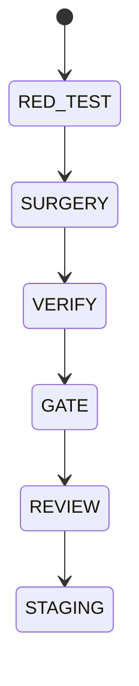

# Domain: brigade

- **Owner / DRI:** @edge-brigade
- **Concepts:** `zero-touch-worktree`, `native-worktree-fallback`, `exit-code-fsm`, `atomic-state-store`, `bounded-navigation`, `github-issues-ssot`, `fail-fast-tracker-auth`, `ephemeral-spec-cache`, `cross-os-runtime-env`, `doctor-preflight`, `cross-os-visual-bridge`, `cross-os-cli-entrypoints`

## Living Invariants
- **[INV-BRIGADE-ZERO-TOUCH-TREE]** Production code and test edits occur exclusively inside an isolated leased worktree, never in the primary working tree.
- **[INV-BRIGADE-TEST-IMMUTABLE]** `CODER` and `SURGEON` never modify, delete, or weaken tests authored by `SEAM_ARCHITECT` to force passing runs.
- **[INV-BRIGADE-ATOMIC-STATE]** Brigade state, local tracker issues, and flight-recorder persistence commit atomically via temporary sibling writes and atomic replacement.
- **[INV-BRIGADE-BOUNDED-NAV]** Navigation slicing bounds index rows, scoped glossary terms, domain deeds, and co-change hints to `<= 15` lines with stale-link flagging.
- **[INV-BRIGADE-FAIL-FAST-AUTH]** Remote tracker operations fail fast before git merges when authentication or binaries are missing, while post-merge issue closure degrades with warnings so state machines never split-brain.
- **[INV-BRIGADE-CROSS-OS-ENV]** Host platform detection, guest path translation, and shared runtime state resolution rely purely on standard-library primitives without hardcoded user or distribution defaults.
- **[INV-BRIGADE-WORKTREE-CLEANUP]** Native worktrees resolve outside the target repository, guard branch deletion by ancestry, preserve aborted commits on abort recovery branches, and support deterministic orphan pruning.

## Adopted Patterns
- **[PAT-BRIGADE-EXITCODE-FSM]** Every state transition advances strictly via deterministic exit codes across verification gates.
- **[PAT-BRIGADE-BOUNDED-NAV]** Domain deeds and scoped concept glossaries are sliced on demand without loading full specifications into worker context.
- **[PAT-BRIGADE-ISSUES-SSOT]** Slice specifications and execution tickets resolve through the unified tracker chain (`gh-axi -> gh -> local`) with parent specifications cached ephemerally at the primary repository root.
- **[PAT-BRIGADE-DOCTOR-PREFLIGHT]** Cross-platform readiness checks probe installed tools non-destructively, classify the capability tier, and initialize machine configuration atomically.
- **[PAT-BRIGADE-NATIVE-FALLBACKS]** Cross-OS workflows degrade gracefully from optional external tools to native worktrees, direct interpreter wrappers, and artifact or browser subagent fallbacks without shell injection.

