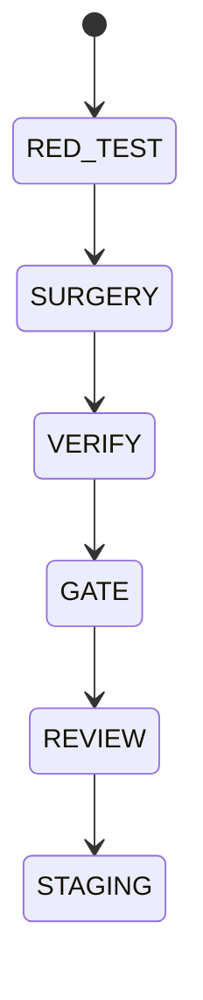

# Domain: brigade

- **Owner / DRI:** @edge-brigade
- **Concepts:** `zero-touch-worktree`, `exit-code-fsm`, `atomic-state-store`, `bounded-navigation`

## Living Invariants
- **[INV-BRIGADE-ZERO-TOUCH-TREE]** Production code and test edits occur exclusively inside an isolated leased worktree, never in the primary working tree.
- **[INV-BRIGADE-TEST-IMMUTABLE]** `CODER` and `SURGEON` never modify, delete, or weaken tests authored by `SEAM_ARCHITECT` to force passing runs.
- **[INV-BRIGADE-ATOMIC-STATE]** Brigade state and flight-recorder persistence commit atomically via temporary writes and atomic replacement.
- **[INV-BRIGADE-BOUNDED-NAV]** Navigation slicing bounds index rows, scoped glossary terms, domain deeds, and co-change hints to `<= 15` lines with stale-link flagging.

## Adopted Patterns
- **[PAT-BRIGADE-EXITCODE-FSM]** Every state transition advances strictly via deterministic exit codes across verification gates.
- **[PAT-BRIGADE-BOUNDED-NAV]** Domain deeds and scoped concept glossaries are sliced on demand without loading full specifications into worker context.

