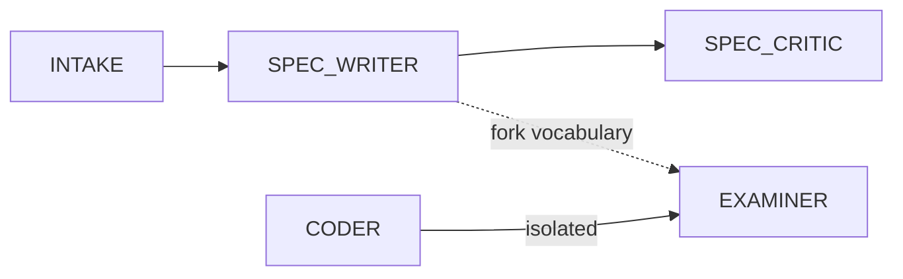

# Domain: orchestration

- **Owner / DRI:** @edge-orchestration
- **Concepts:** `zero-handoff-guard`, `elephant-station-reuse`, `goldfish-ephemeral-review`, `strategic-context-fork`, `session-gated-hooks`, `fail-open-dispatch`

## Living Invariants
- **[INV-ORCH-HOOK-LATENCY]** Orchestrator guards execute deterministically without model calls and block direct orchestrator source or test edits.
- **[INV-ORCH-SESSION-GATE]** Lifecycle guards remain completely passive in standard conversations until an explicit orchestrator invocation or active station marker arms the session.
- **[INV-ORCH-FAIL-OPEN]** Missing runtimes, disabled kill switches, malformed payloads, or internal dispatcher faults always exit cleanly and permit execution without blocking the host IDE.
- **[INV-ORCH-ELEPHANT-REUSE]** Persistent elephant stations (`SPEC_WRITER`, `RESEARCHER`, `SEAM_ARCHITECT`, `CODER`, `SURGEON`, `QA_ENGINEER`) reuse active sessions in the green token zone instead of spawning duplicates.
- **[INV-ORCH-GOLDFISH-FRESH]** Ephemeral goldfish stations (`SPEC_CRITIC`, `EXAMINER`) always start with zero coder or surgeon history to eliminate confirmation bias.
- **[INV-ORCH-PARENT-SPEC-SSOT]** Parent specification issues serve as the single source of truth for vertical slice intake and review, while legacy file-based backlog trackers remain soft-deprecated.

## Adopted Patterns
- **[PAT-ORCH-ZERO-HANDOFF]** The orchestrator delegates all code inspection and editing to canonical stations while keeping Phase 0 glossary alignment and intake in the green zone.
- **[PAT-ORCH-STRATEGIC-FORK]** Reviewers (`EXAMINER`) inherit domain vocabulary from `SPEC_WRITER` or `RESEARCHER`, never from `CODER` or `SURGEON`.

