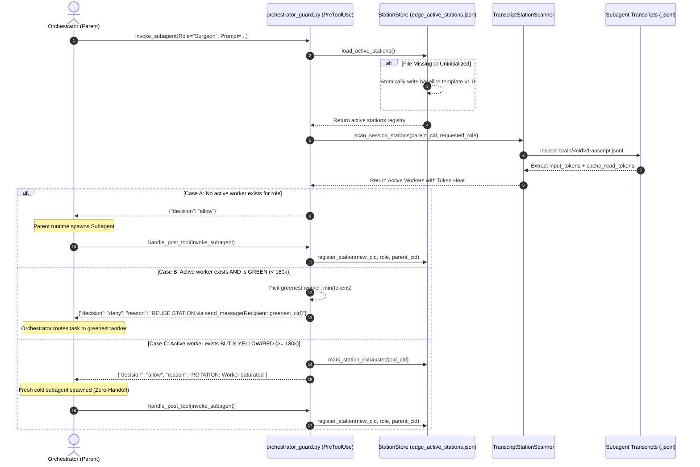
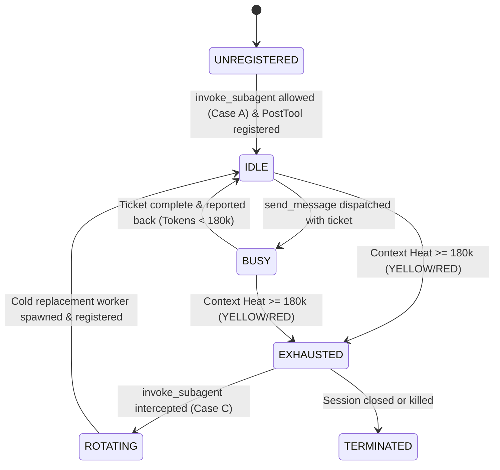

# 🏛️ Edge Brigade Specification: Antigraveyard Station Persistence, Discovery & Rotation Engine

> **Document ID:** `SPEC-EDGE-BRIGADE-001`  
> **Status:** `APPROVED / AUTHORITATIVE`  
> **Author:** `SPEC_WRITER Station Worker`  
> **Target Subsystems:** `tools/brigade/orchestrator_guard.py`, `tools/brigade/stations.py`, `tools/brigade/models.py`  
> **Target Test Suite:** `tests/test_brigade_guard.py`  
> **Operating Environment:** WSL2 Ubuntu-24.04 (`/mnt/c/Users/oguz_/.gemini/config/plugins/edge`)  

---

## 📑 Table of Contents
1. [Executive Summary & Background](#1-executive-summary--background)
2. [Ubiquitous Language & Domain Model](#2-ubiquitous-language--domain-model)
3. [The Michelin Brigade & Station Rotation Metaphor](#3-the-michelin-brigade--station-rotation-metaphor)
   - [3.1 The Specialization Principle](#31-the-specialization-principle)
   - [3.2 The Zero-Handoff Invariant](#32-the-zero-handoff-invariant)
   - [3.3 Anti-Graveyard Mathematical Model](#33-anti-graveyard-mathematical-model)
4. [Architecture & System Flow](#4-architecture--system-flow)
   - [4.1 Component Interaction Sequence Diagram](#41-component-interaction-sequence-diagram)
   - [4.2 Station Lifecycle State Machine](#42-station-lifecycle-state-machine)
5. [Component 1: StationStore & Baseline Template](#5-component-1-stationstore--baseline-template)
   - [5.1 Storage Contract & Baseline Schema](#51-storage-contract--baseline-schema)
   - [5.2 Atomic Persistence Protocol](#52-atomic-persistence-protocol)
   - [5.3 Backward Compatibility & Legacy Migration](#53-backward-compatibility--legacy-migration)
6. [Component 2: TranscriptStationScanner (Ground Truth Discovery)](#6-component-2-transcriptstationscanner-ground-truth-discovery)
   - [6.1 Transcript-as-Ground-Truth Protocol](#61-transcript-as-ground-truth-protocol)
   - [6.2 Tool Call & Conversation Pairing](#62-tool-call--conversation-pairing)
   - [6.3 Context Heat & Token Calculation Engine](#63-context-heat--token-calculation-engine)
   - [6.4 Canonical Role Normalization](#64-canonical-role-normalization)
7. [Component 3: StationSelector & Context Heat Rotation](#7-component-3-stationselector--context-heat-rotation)
   - [7.1 Heat Zone Thresholds](#71-heat-zone-thresholds)
   - [7.2 Decision Triad (Case A, B, C)](#72-decision-triad-case-a-b-c)
   - [7.3 Greenest Worker Selection Algorithm](#73-greenest-worker-selection-algorithm)
   - [7.4 Zero-Handoff Rotation Protocol](#74-zero-handoff-rotation-protocol)
8. [Formal Acceptance Criteria (Gherkin Scenarios)](#8-formal-acceptance-criteria-gherkin-scenarios)
9. [Seam Contracts & Concrete Python Interfaces](#9-seam-contracts--concrete-python-interfaces)
10. [Comprehensive Test Plan for `test_brigade_guard.py`](#10-comprehensive-test-plan-for-test_brigade_guardpy)

---

## 1. Executive Summary & Background

In prior implementations of the Edge Orchestrator and Brigade workflows, subagents were spawned ephemerally for individual tasks. This led to **Subagent Graveyard Sprawl**: dozens of idle, abandoned subagents polluting the workspace, consuming memory and logs, while the parent Orchestrator continually paid prompt-overhead tokens to re-spawn new workers for standard operational roles.

To achieve industrial reliability, determinism, and token conservation, this specification formalizes the **Station Persistence, Discovery, and Rotation Engine**. The engine enforces persistent, reusable station workers across the canonical 9 stations of Edge Brigade, discovers existing workers from append-only transcript logs (the ground truth), tracks their context heat in real time, intercepts redundant spawning attempts in `PreToolUse`, and cleanly rotates workers when cognitive saturation thresholds are reached.

---

## 2. Ubiquitous Language & Domain Model

| Term | Ubiquitous Definition |
| :--- | :--- |
| **Kitchen Brigade (Brigade de Cuisine)** | The architectural metaphor governing agent collaboration. Agents do not act as generalist chat bots; they act as disciplined culinary station masters with strict role contracts. |
| **Station (İstasyon)** | A permanent operational desk in the kitchen assigned to a specific domain role (e.g. `SURGEON`, `SEAM_ARCHITECT`, `SPEC_WRITER`). |
| **Station Worker (İstasyon Çalışanı)** | A persistent subagent instance (identified by a unique `conversationId`) bound to a station. Station workers remain active and `IDLE` between tickets, awaiting assignments via `send_message`. |
| **Zero-Handoff Invariant** | The architectural rule dictating that when a station worker is replaced due to context saturation, **NO** complex LLM memory summary or conversational compaction is generated. Because all task packages are self-contained, a cold replacement worker takes the station immediately. |
| **Context Heat Zone** | The quantitative cognitive load of an agent based on processed token volume: **GREEN** (< 180k tokens), **YELLOW** (180k - 250k tokens), and **RED** (> 250k tokens). |
| **Ground Truth Transcript** | The immutable, append-only JSONL event log (`transcript.jsonl`) generated by Antigravity runtime. It represents the single source of truth for agent actions, subagent creation, and token consumption. |
| **StationStore** | The persistent, atomic storage abstraction managing `edge_active_stations.json`, guaranteeing template integrity, atomic writes, and backward compatibility. |
| **TranscriptStationScanner** | The discovery engine that scans parent and subagent transcripts to pair `invoke_subagent` calls with created `conversationId`s and compute real-time context heat. |
| **StationSelector** | The deterministic policy engine operating in `PreToolUse` that decides whether an `invoke_subagent` call is allowed, intercepted (denied with redirection to `send_message`), or rotated. |
| **Greenest Worker** | When multiple workers exist for a station, the worker with the lowest total token count (`min(tokens)`). |

---

## 3. The Michelin Brigade & Station Rotation Metaphor

### 3.1 The Specialization Principle
> *"Tatlıcı sadece tatlı yapar, çorbacı sadece çorba yapar. Sadece çorbanın malzemesi değişir."*  
> *(The pastry chef only makes pastries; the soup chef only makes soups. Only the ingredients change.)*

In a Michelin-starred kitchen, stations are permanent fixtures. The Saucier does not turn into a Pâtissier midway through dinner service. Similarly, in Edge Brigade:
1. Each station worker is initialized with a hyper-specialized role definition, strict filesystem boundaries, and specialized tooling.
2. A station worker does not cross into another station's territory (e.g., `EXPEDITER` cannot edit `src/`, `CODER` cannot alter tests in `tests/`, `SPEC_EXAMINER` is strictly read-only).
3. The Orchestrator does not spawn a new worker when a new dish (ticket) arrives. It sends the ticket package to the existing, waiting station worker via `send_message`.

### 3.2 The Zero-Handoff Invariant
In traditional agent architectures, rotating a tired agent requires complex "memory compaction", "context summarization", or multi-agent handoff protocols. In practice, LLM summarization is prone to:
- Loss of exact file paths and compiler errors.
- Hallucinated assumptions about prior implementation states.
- High token expenditure spent summarizing stale history.

**Edge Brigade eliminates handoff entirely via the Zero-Handoff Invariant:**
- Every ticket produced by Edge Brigade (`Ticket` dataclass) is **100% self-contained and hermetic**.
- A ticket explicitly declares: `target_file`, `line_number`, `rule_id`, `branch_name`, `test_seam_command`, `negative_constraints`, and `suggested_fix`.
- When a station worker exhausts its context (crossing into YELLOW or RED zones), it is dismissed. A brand new, cold subagent is spawned to take over the station.
- The cold subagent receives the ticket package and executes from the physical truth on disk (the Git branch, the compiler, the test runner). It requires **zero knowledge** of previous tickets executed by its predecessor.

```
┌────────────────────────────────────────────────────────────────────────┐
│                        ZERO-HANDOFF ROTATION                           │
│                                                                        │
│   [Worker #1: Saturated] ────(Tokens >= 180k)────► [Marked EXHAUSTED]  │
│                                                          │             │
│                                                    (No Summaries)      │
│                                                    (No Token Waste)    │
│                                                          │             │
│   [Worker #2: Fresh Cold] ◄───(Self-Contained Ticket)────┘             │
│   • Pure Station Prompt                                                │
│   • Exact Git Branch State                                             │
│   • Hermetic Test Seam Command                                         │
└────────────────────────────────────────────────────────────────────────┘
```

### 3.3 Anti-Graveyard Mathematical Model
Let $N$ be the number of tickets processed in a session, and $S$ be the number of active stations ($S \le 9$).
- **Without Station Persistence (Disposable Model):**
  $$\text{Subagents Spawned} = N \times S$$
  For a 10-ticket refactor run across 4 stations, $\mathbf{40}$ disposable subagents are created. Context windows are repeatedly initialized, wasting up to $\approx 300,000$ redundant preamble tokens.
- **With Station Persistence & Heat-Aware Rotation:**
  $$\text{Subagents Spawned} = S + \sum_{i=1}^S \left\lfloor \frac{\text{Tokens}_i}{180,000} \right\rfloor$$
  For the same 10-ticket run, only $\mathbf{4}$ subagents are spawned initially, rotating only when a specific station worker reaches 180,000 tokens. Total spawned agents drop by $\mathbf{80\%-90\%}$.

---

## 4. Architecture & System Flow

### 4.1 Component Interaction Sequence Diagram

The following sequence details how the Orchestrator's attempt to call `invoke_subagent` is evaluated against ground truth transcripts, active station persistence, and context heat.



### 4.2 Station Lifecycle State Machine



---

## 5. Component 1: StationStore & Baseline Template

### 5.1 Storage Contract & Baseline Schema
The station store is located at `ACTIVE_STATIONS_FILE`:
- Default WSL path: `/mnt/c/Users/oguz_/.gemini/antigravity/edge_active_stations.json`
- Fallback paths: `~/.gemini/antigravity/edge_active_stations.json` or `/tmp/edge_active_stations.json`.

When the file does not exist on disk, `load_active_stations()` **MUST NOT** return an unpersisted empty dictionary. It must atomically write and persist the following structured JSON document:

```json
{
  "version": "1.0",
  "initializedAt": "2026-10-15T03:39:00Z",
  "sessions": {},
  "stations": {}
}
```

#### Schema Definitions
- **`version`** (`string`, mandatory): Schema version, fixed at `"1.0"`.
- **`initializedAt`** (`string`, mandatory): ISO 8601 UTC timestamp of creation.
- **`sessions`** (`Record<string, SessionNode>`): Map of `parentConversationId` to session-level metadata:
  ```json
  {
    "orch-parent-123": {
      "parentConversationId": "orch-parent-123",
      "registeredStations": ["conv-surgeon-001", "conv-exp-002"],
      "lastScannedAt": "2026-10-15T03:45:00Z"
    }
  }
  ```
- **`stations`** (`Record<string, StationNode>`): Map of subagent `conversationId` to station records:
  ```json
  {
    "conv-surgeon-001": {
      "conversationId": "conv-surgeon-001",
      "role": "SURGEON",
      "canonicalRole": "SURGEON",
      "parentConversationId": "orch-parent-123",
      "status": "IDLE",
      "registeredAt": "2026-10-15T03:40:00Z",
      "lastActiveAt": "2026-10-15T03:45:00Z",
      "tokenHeat": {
        "tokens": 42150,
        "heatZone": "GREEN",
        "lastCalculatedAt": "2026-10-15T03:45:00Z"
      }
    }
  }
  ```

### 5.2 Atomic Persistence Protocol
To prevent race conditions, corrupted partial writes, or concurrent file access issues between parent orchestrators and subagents, writes must follow the atomic rename pattern:
1. Serialize JSON payload with `indent=2, ensure_ascii=False`.
2. Write directly to a sibling temporary file: `ACTIVE_STATIONS_FILE.with_suffix(".tmp")`.
3. Flush and close the temporary file descriptor.
4. Execute atomic filesystem replacement: `temp_file.replace(ACTIVE_STATIONS_FILE)`.

### 5.3 Backward Compatibility & Legacy Migration
Existing tests and legacy callers may expect `load_active_stations()` to interact directly with a dictionary of stations or access keys via `data[cid]`.

**The StationStore satisfies both old and new contracts via Dual-Interface Normalization:**
1. **On Load (Disk -> Memory):**
   - If the file on disk is in the legacy flat format (`{"<cid>": {"role": "EXPEDITER", ...}}` without root `"version"` or `"stations"` keys):
     - The legacy data is automatically migrated into the `"stations"` sub-tree.
     - The template envelope is generated and atomically written to disk.
2. **Envelope Dictionary (`StationStoreEnvelope`):**
   - `load_active_stations()` returns a dictionary subclass that supports:
     - Direct root access: `data["stations"]`, `data["sessions"]`, `data["version"]`.
     - Legacy transparent key lookup: `data[cid]` and `cid in data` seamlessly proxy to `data["stations"][cid]`.
     - Direct iteration: `data.items()` or `data.get_stations()` guarantees legacy compatibility for iteration loops in existing code.
3. **On Save (Memory -> Disk):**
   - If a caller passes a raw flat dictionary (`{"<cid>": {...}}`), `save_active_stations` wraps it in the v1.0 template before writing.

---

## 6. Component 2: TranscriptStationScanner (Ground Truth Discovery)

### 6.1 Transcript-as-Ground-Truth Protocol
`edge_active_stations.json` serves as a fast index, but the **absolute ground truth** is the immutable parent transcript (`transcript.jsonl`).
- If an agent crashes or the JSON cache is deleted, the scanner reconstructs the active station topology entirely from the parent transcript.
- If the station file contains records for subagents that do not exist in the parent transcript, the transcript takes precedence.

### 6.2 Tool Call & Conversation Pairing
The scanner evaluates the parent `transcript.jsonl` sequentially:
1. Locate step $S_i$ where `source == "MODEL"` and `tool_calls` contains:
   ```json
   {
     "name": "invoke_subagent",
     "args": {
       "Subagents": [{"Role": "Refactor Surgeon", "Prompt": "..."}]
     }
   }
   ```
2. Inspect subsequent steps $S_{i+1} \dots S_{i+3}$ to find the corresponding system creation confirmation:
   ```json
   {
     "source": "MODEL" | "SYSTEM",
     "content": "Created the following subagents:\n{\n  \"conversationId\": \"a1b2c3d4-e5f6-7890-abcd-ef1234567890\",\n  \"logAbsoluteUri\": \"...\"\n}"
   }
   ```
3. Extract `conversationId` via regular expression:
   `r'\\*"conversationId\\*":\s*\\*"([a-f0-9\-]+)\\*"'`
4. Pair the `conversationId` with the normalized canonical role extracted from `args.Subagents[0].Role`.

### 6.3 Context Heat & Token Calculation Engine
For each discovered subagent `conversationId`, the scanner locates the subagent transcript:
- **Subagent Transcript Path:**  
  `<appDataDir>/brain/<conversationId>/.system_generated/logs/transcript.jsonl`  
  (Mapped to WSL: `/mnt/c/Users/oguz_/.gemini/antigravity/brain/<conversationId>/.system_generated/logs/transcript.jsonl`).

#### Calculation Formula:
1. **Primary Metric (Exact Token Counter):**
   Read the final steps of the subagent transcript. Extract metrics from the last step or compute the maximum token snapshot:
   $$\text{current\_tokens} = \text{last\_step.input\_tokens} + \text{last\_step.cache\_read\_tokens}$$
   *(If `total_tokens` or `tokens` field is present on step metadata, use `max(step_tokens)`).*
2. **Secondary Heuristic (Character Fallback):**
   If the runtime step metadata lacks explicit token metrics, compute the deterministic character ratio:
   $$\text{current\_tokens} = \left\lfloor \frac{\sum_{l \in \text{transcript}} \text{len}(l)}{4} \right\rfloor$$
3. **Missing File Default:**
   If a subagent has just been spawned and its transcript file is not yet flushed to disk, `tokens = 0` (GREEN).

### 6.4 Canonical Role Normalization
The scanner and guard map all variations of input role names to the canonical 9 Edge Brigade stations:

```python
CANONICAL_ROLES: Dict[str, List[str]] = {
    "EXPEDITER": ["expediter", "aboyeur", "coordinator", "dispatcher", "isolation", "test runner", "qa runner"],
    "SPEC_WRITER": ["spec_writer", "spec writer", "spec-writer", "translator", "slicer", "n-spec"],
    "RESEARCHER": ["researcher", "research", "recon", "reconnaissance", "investigator", "rca", "root cause"],
    "SEAM_ARCHITECT": ["seam_architect", "seam architect", "seam-architect", "contract", "test author", "red test", "tdd"],
    "CODER": ["coder", "programmer", "worker", "implementer", "production worker"],
    "SURGEON": ["surgeon", "refactor", "refactorer", "chef de partie", "decoupling"],
    "STANDARDS_EXAMINER": ["standards_examiner", "standards examiner", "standards-examiner", "sous chef", "smell auditor"],
    "SPEC_EXAMINER": ["spec_examiner", "spec examiner", "spec-examiner", "maitre d", "architectural examiner"],
    "QA_ENGINEER": ["qa_engineer", "qa", "e2e", "e2e_tester", "sommelier", "inspector", "test_agent", "qa agent"],
}
```

---

## 7. Component 3: StationSelector & Context Heat Rotation

### 7.1 Heat Zone Thresholds
Following Edge Brigade cognitive safety limits:
- 🟢 **GREEN Zone (`tokens < 180,000`):** Normal operation. Station worker is cognitively fresh and responsive.
- 🟡 **YELLOW Zone (`180,000 <= tokens <= 250,000`):** Cognitive drain zone. Active tasks may be drained, but new tickets must not be assigned. Station must rotate before receiving fresh tickets.
- 🔴 **RED Zone (`tokens > 250,000`):** Critical saturation zone. High hallucination risk. Immediate rotation mandatory.

### 7.2 Decision Triad (Case A, B, C)
When an `invoke_subagent` call targeting `canonical_role` is intercepted in `PreToolUse`:

```
                           [invoke_subagent intercepted]
                                         │
                                         ▼
                       Does an active station exist for role?
                                    /         \
                              (No) /           \ (Yes)
                                  ▼             ▼
                           [CASE A: ALLOW]   Inspect token heat of active stations
                           Fresh cold worker   │
                           takes station       ├─► Any worker is GREEN (< 180k)? ──► [CASE B: DENY]
                                               │                                     Select greenest: min(tokens)
                                               │                                     Redirect to send_message
                                               │
                                               └─► ALL workers YELLOW/RED (>= 180k)? ► [CASE C: ALLOW]
                                                                                     Rotate station (Zero-Handoff)
                                                                                     Spawn fresh cold worker
```

#### Case A: No Active Station Exists for Role
- **Precondition:** Registry has no worker for `canonical_role` under `parentConversationId`.
- **Policy Decision:** `{"decision": "allow"}`.
- **Side Effect:** Spawning proceeds. In `handle_post_tool`, the newly assigned `conversationId` is registered as the active station worker with status `IDLE`.

#### Case B: Station Exists and is GREEN (< 180,000 tokens)
- **Precondition:** One or more workers exist with `tokenHeat.tokens < 180,000`.
- **Selection:** If multiple exist, identify the **Greenest Worker**:
  $$\text{Target} = \arg\min_{w \in \text{Workers}} (w.\text{tokens})$$
- **Policy Decision:** `{"decision": "deny"}`.
- **Denial Reason (Remediation Directive):**
  ```text
  ❌ [PERSISTENT STATION REUSE REQUIRED]: An active, healthy station worker for role '{role}' 
  already exists in this session (conversationId: '{greenest_cid}', heat: GREEN, {tokens} tokens).

  🛑 ANTI-GRAVEYARD PROTOCOL ENFORCED:
  Do NOT call `invoke_subagent` to spawn duplicate subagents!
  You must reuse the existing persistent station worker by sending your task package via:
  `send_message(Recipient: "{greenest_cid}", Message: ...)`
  ```

#### Case C: Station Exists but is Exhausted (>= 180,000 tokens)
- **Precondition:** All existing workers for `canonical_role` have `tokens >= 180,000`.
- **Action:** The saturated worker is marked `status = "EXHAUSTED"` or `"ROTATED"`.
- **Policy Decision:** `{"decision": "allow"}`.
- **Zero-Handoff Execution:** The parent is permitted to invoke a brand new cold subagent.
- **Post-Tool Registration:** The new worker is registered and immediately becomes the sole active GREEN worker for that station.

---

## 8. Formal Acceptance Criteria (Gherkin Scenarios)

```gherkin
Feature: Edge Brigade Antigraveyard Station Persistence & Rotation Engine

  Background:
    Given the environment is initialized in WSL2 Ubuntu
    And the active station storage path is isolated to a temporary directory

  # -------------------------------------------------------------------------
  # Component 1: StationStore & Baseline Template
  # -------------------------------------------------------------------------

  Scenario: Atomically initialize baseline template on missing store file
    Given "edge_active_stations.json" does not exist on disk
    When the orchestrator guard loads the active stations
    Then a valid JSON file "edge_active_stations.json" must be created atomically on disk
    And the root JSON must contain "version" equal to "1.0"
    And the root JSON must contain a valid ISO 8601 "initializedAt" timestamp
    And the root JSON must contain an empty "sessions" object
    And the root JSON must contain an empty "stations" object

  Scenario: Transparently migrate legacy flat station format to v1.0 template
    Given a legacy "edge_active_stations.json" exists containing:
      """
      {
        "legacy-cid-1": {
          "role": "EXPEDITER",
          "parentConversationId": "orch-1",
          "status": "IDLE"
        }
      }
      """
    When the orchestrator guard loads the active stations
    Then the returned envelope must allow direct access to "legacy-cid-1"
    And the file on disk must be migrated to include root "version": "1.0"
    And the station "legacy-cid-1" must reside under the "stations" key

  # -------------------------------------------------------------------------
  # Component 2: TranscriptStationScanner & Ground Truth Discovery
  # -------------------------------------------------------------------------

  Scenario: Reconstruct station topology from parent transcript
    Given a parent transcript "transcript.jsonl" contains:
      | Step | Type           | Details                                                                    |
      | 10   | MODEL          | invoke_subagent(Role="Refactor Surgeon")                                   |
      | 11   | MODEL_RESPONSE | Created the following subagents: {"conversationId": "subagent-surg-456"}  |
    When the TranscriptStationScanner scans the parent transcript
    Then station "subagent-surg-456" must be discovered
    And its canonical role must be resolved to "SURGEON"

  Scenario: Accurately calculate context heat from subagent transcript steps
    Given a subagent "subagent-surg-456" transcript exists with final step tokens:
      | input_tokens | cache_read_tokens |
      | 45000        | 12000             |
    When the TranscriptStationScanner evaluates "subagent-surg-456"
    Then the computed token count must be 57000
    And the assigned heat zone must be "GREEN"

  # -------------------------------------------------------------------------
  # Component 3: StationSelector & Context Heat Rotation
  # -------------------------------------------------------------------------

  Scenario: Case A - First invocation of a station role is allowed
    Given no active station worker exists for role "SEAM_ARCHITECT"
    When the Orchestrator invokes subagent with Role "Seam Architect"
    Then PreToolUse decision must be "allow"
    And when PostToolUse receives confirmation for "cid-seam-789"
    Then "cid-seam-789" must be registered in StationStore as active "SEAM_ARCHITECT"

  Scenario: Case B - Spawning duplicate for GREEN worker is denied and redirected
    Given an active station worker "cid-coder-111" exists for "CODER"
    And its context heat is 45,000 tokens ("GREEN")
    When the Orchestrator invokes subagent with Role "Coder"
    Then PreToolUse decision must be "deny"
    And the denial reason must contain "PERSISTENT STATION REUSE REQUIRED"
    And the denial reason must instruct using "send_message" with Recipient "cid-coder-111"

  Scenario: Case B with Multi-Worker - Pick greenest active worker
    Given station worker "cid-qa-old" exists with 140,000 tokens ("GREEN")
    And station worker "cid-qa-fresh" exists with 22,000 tokens ("GREEN")
    When the Orchestrator invokes subagent with Role "QA_ENGINEER"
    Then PreToolUse decision must be "deny"
    And the denial reason must select "cid-qa-fresh" as the reuse target

  Scenario: Case C - Exhausted YELLOW or RED worker triggers zero-handoff rotation
    Given an active station worker "cid-spec-exhausted" exists for "SPEC_WRITER"
    And its context heat is 195,000 tokens ("YELLOW")
    When the Orchestrator invokes subagent with Role "Spec Writer"
    Then PreToolUse decision must be "allow"
    And "cid-spec-exhausted" must be marked as "EXHAUSTED" in StationStore
    And when PostToolUse receives confirmation for fresh subagent "cid-spec-fresh"
    Then "cid-spec-fresh" must be registered as the new active "SPEC_WRITER"
```

---

## 9. Seam Contracts & Concrete Python Interfaces

The implementation shall introduce the following typed contracts in `tools/brigade/orchestrator_guard.py` and `tools/brigade/stations.py`:

```python
from dataclasses import dataclass, field, asdict
from datetime import datetime, timezone
from pathlib import Path
from typing import Dict, Any, Optional, Tuple, List, Union


# =============================================================================
# 1. Models & Envelope Data Contracts
# =============================================================================

@dataclass
class TokenHeatRecord:
    tokens: int
    heat_zone: str  # "GREEN" | "YELLOW" | "RED"
    last_calculated_at: str = field(default_factory=lambda: datetime.now(timezone.utc).isoformat())

    def to_dict(self) -> Dict[str, Any]:
        return asdict(self)


@dataclass
class StationRecord:
    conversation_id: str
    role: str
    canonical_role: str
    parent_conversation_id: str
    status: str = "IDLE"  # "IDLE" | "BUSY" | "EXHAUSTED" | "ROTATED"
    registered_at: str = field(default_factory=lambda: datetime.now(timezone.utc).isoformat())
    last_active_at: str = field(default_factory=lambda: datetime.now(timezone.utc).isoformat())
    token_heat: TokenHeatRecord = field(default_factory=lambda: TokenHeatRecord(tokens=0, heat_zone="GREEN"))

    def to_dict(self) -> Dict[str, Any]:
        return {
            "conversationId": self.conversation_id,
            "role": self.role,
            "canonicalRole": self.canonical_role,
            "parentConversationId": self.parent_conversation_id,
            "status": self.status,
            "registeredAt": self.registered_at,
            "lastActiveAt": self.last_active_at,
            "tokenHeat": self.token_heat.to_dict(),
        }


class StationStoreEnvelope(dict):
    """
    Transparent dictionary envelope supporting both legacy flat access:
        data[cid] -> returns station record
        cid in data -> checks station presence
    and structured template access:
        data["version"], data["stations"], data["sessions"]
    """
    def __init__(self, *args, **kwargs):
        super().__init__(*args, **kwargs)
        if "stations" not in self:
            self["stations"] = {}
        if "sessions" not in self:
            self["sessions"] = {}
        if "version" not in self:
            self["version"] = "1.0"
        if "initializedAt" not in self:
            self["initializedAt"] = datetime.now(timezone.utc).isoformat()

    def __getitem__(self, key: str) -> Any:
        if key in ("version", "initializedAt", "sessions", "stations"):
            return super().__getitem__(key)
        stations = super().__getitem__("stations")
        if key in stations:
            return stations[key]
        return super().__getitem__(key)

    def __contains__(self, key: object) -> bool:
        if super().__contains__(key):
            return True
        stations = super().get("stations", {})
        return key in stations

    def get_stations(self) -> Dict[str, Dict[str, Any]]:
        return super().get("stations", {})


# =============================================================================
# 2. Component 1: StationStore Contract
# =============================================================================

class StationStore:
    def __init__(self, store_path: Path):
        self.store_path = store_path

    def load(self) -> StationStoreEnvelope:
        """Loads store from disk, initializing template atomically if missing."""
        ...

    def save(self, envelope: Union[StationStoreEnvelope, Dict[str, Any]]) -> None:
        """Atomically persists envelope to disk via temporary file rename."""
        ...

    def register(self, conversation_id: str, role: str, parent_cid: str = "") -> StationRecord:
        """Registers a newly spawned subagent station worker."""
        ...

    def mark_exhausted(self, conversation_id: str) -> None:
        """Marks a saturated worker as EXHAUSTED prior to rotation."""
        ...


# =============================================================================
# 3. Component 2: TranscriptStationScanner Contract
# =============================================================================

class TranscriptStationScanner:
    def __init__(self, brain_root: Path):
        self.brain_root = brain_root

    def discover_session_stations(self, parent_transcript_path: Path) -> List[Tuple[str, str]]:
        """
        Parses parent transcript to pair invoke_subagent calls with subsequent
        system confirmation steps, returning list of (conversation_id, raw_role).
        """
        ...

    def calculate_subagent_heat(self, conversation_id: str) -> TokenHeatRecord:
        """
        Inspects subagent transcript at brain/<cid>/.system_generated/logs/transcript.jsonl
        and computes exact token count (input + cache_read) or character fallback.
        """
        ...


# =============================================================================
# 4. Component 3: StationSelector Contract
# =============================================================================

class StationSelector:
    @staticmethod
    def evaluate_spawn_request(
        store: StationStore,
        scanner: TranscriptStationScanner,
        parent_cid: str,
        requested_role: str
    ) -> Dict[str, str]:
        """
        Evaluates an invoke_subagent request against Cases A, B, and C.
        Returns {"decision": "allow"} or {"decision": "deny", "reason": "..."}.
        """
        ...
```

---

## 10. Comprehensive Test Plan for `test_brigade_guard.py`

The test suite in `tests/test_brigade_guard.py` shall be extended with dedicated test classes verifying all three components:

### Test Class: `TestStationStorePersistence`
- `test_atomic_initialization_on_missing_file`:
  Verify file creation, permissions, and exact presence of `"version": "1.0"`, `"initializedAt"`, `"sessions": {}`, `"stations": {}`.
- `test_legacy_flat_dictionary_migration`:
  Seed store with flat `{ "cid-1": { "role": "EXPEDITER" } }`. Call `load_active_stations()`. Confirm disk migration to `"stations": {"cid-1": ...}` and envelope transparency (`data["cid-1"]`).
- `test_atomic_write_concurrency_safety`:
  Simulate write failures to ensure `.tmp` cleanup and zero file corruption on interrupted write.

### Test Class: `TestTranscriptStationScanner`
- `test_parse_invoke_subagent_pairing`:
  Provide realistic JSONL snippet with multi-line system confirmation. Verify accurate extraction of `conversationId` and role mapping.
- `test_calculate_token_heat_exact`:
  Provide mock subagent transcript with `input_tokens: 40000, cache_read_tokens: 15000`. Assert token count 55,000 and zone `GREEN`.
- `test_calculate_token_heat_fallback`:
  Provide mock subagent transcript without token metadata (40,000 raw characters). Assert fallback `total_chars // 4 == 10000`.

### Test Class: `TestStationSelectorRotation`
- `test_case_a_first_role_spawn_allowed`:
  Assert `handle_pre_tool` returns `allow` when station role is unassigned.
- `test_case_b_green_station_denied_with_redirection`:
  Seed station with 50,000 tokens. Assert `deny`, message contains `send_message`, and recipient matches active CID.
- `test_case_b_multi_worker_selects_greenest`:
  Seed Worker 1 with 120,000 tokens and Worker 2 with 30,000 tokens. Assert denial directs Orchestrator specifically to Worker 2.
- `test_case_c_saturated_worker_allows_rotation`:
  Seed station with 190,000 tokens (`YELLOW`). Assert `handle_pre_tool` returns `allow`, existing worker transitions to `EXHAUSTED`, and Zero-Handoff rotation proceeds cleanly.

---

### Verification Command (WSL2-First Doctrine)
```bash
wsl bash -c "cd /mnt/c/Users/oguz_/.gemini/config/plugins/edge && python3 -m unittest discover tests"
```
*All tests must exit with code 0 and maintain 100% backward compatibility.*
