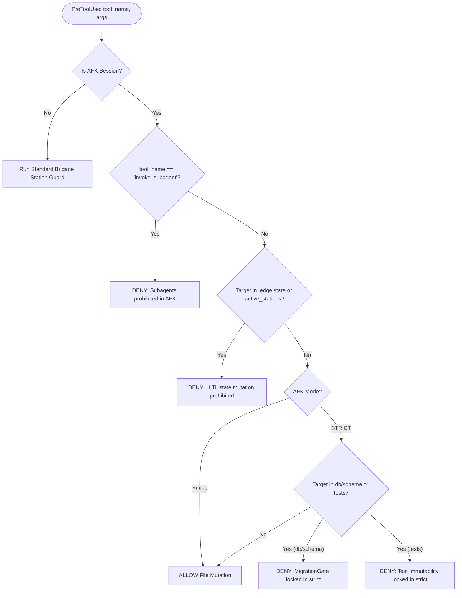
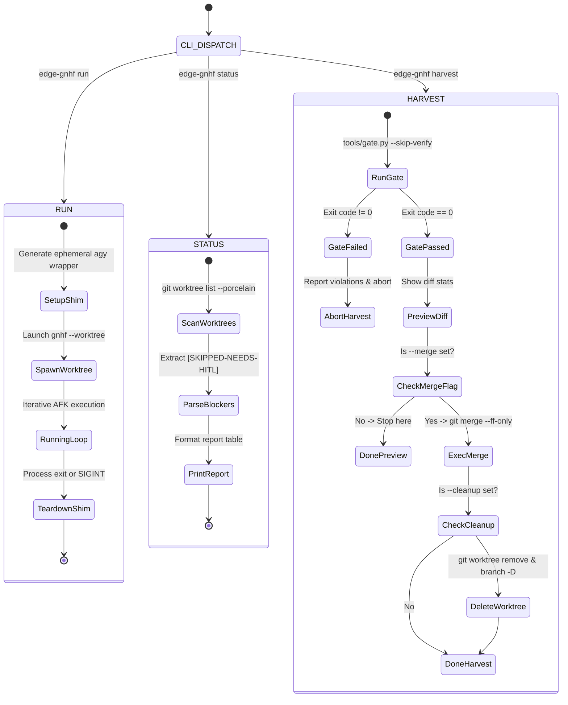

# 🌙 Edge-GNHF: Autonomous Overnight Worktree Engine ("Good Night, Have Fun")
> **Dual-Signal Physical Hook Armor, Ephemeral Quota Shield, Deterministic Lifecycle & Conversational Handshake Architecture**

> **Document ID:** `SPEC-EDGE-GNHF-001`  
> **Status:** `APPROVED / AUTHORITATIVE`  
> **Author:** `SPEC_WRITER Station Worker`  
> **Date:** `2026-10-31`  
> **Target Subsystems:**
> - `tools/gnhf/__init__.py` (Package declaration & module exports)
> - `tools/gnhf/cli.py` (CLI entry point, argument parsing, lifecycle subcommands: `run`, `status`, `harvest`)
> - `tools/gnhf/runner.py` (Subprocess execution engine, worktree management, environment injection)
> - `tools/gnhf/shim.py` (Ephemeral `agy` model injection shim & zero-global-pollution PATH manager)
> - `tools/gnhf/prompt.py` (Deterministic AFK instruction generator & guardrail headers)
> - `tools/gnhf/harvest.py` (Worktree discovery, blocker triage, diff analysis, gate verification, merge & cleanup)
> - `tools/brigade/orchestrator_guard.py` (`EDGE_AFK` dual-signal detection, strict/yolo guard, subagent deny, HITL state protection)
> - `skills/edge-gnhf/SKILL.md` (Human terminal guide & agent conversational handshake protocol)
> - `~/.local/bin/edge-gnhf` (Executable launcher shim)  
> **Target Test Suites:**
> - `tests/test_brigade_guard.py` (AFK hook isolation, dual-signal detection, strict/yolo invariant enforcement)
> - `tests/test_gnhf.py` (Shim creation/teardown, prompt template synthesis, CLI parsing, status aggregation, harvest merge workflow)  
> **Operating Environment:** WSL2 Ubuntu-24.04 (`/home/oguz/.treehouse/edge-10a21d/1/edge`, branch `feat/edge-gnhf`)

---

## 📑 Table of Contents
1. [Executive Summary & Problem Statement](#1-executive-summary--problem-statement)
   - [1.1 The Overnight Autonomous Agent Dilemma](#11-the-overnight-autonomous-agent-dilemma)
   - [1.2 The GNHF Engine & The Edge Plugin Philosophy](#12-the-gnhf-engine--the-edge-plugin-philosophy)
   - [1.3 Core Architectural Tenets](#13-core-architectural-tenets)
2. [Ubiquitous Language & Domain Invariants](#2-ubiquitous-language--domain-invariants)
   - [2.1 Ubiquitous Language & Terminology](#21-ubiquitous-language--terminology)
   - [2.2 The Seven Non-Negotiable Invariants](#22-the-seven-non-negotiable-invariants)
3. [Subsystem 1: Dual-Signal AFK Hook Armor (`tools/brigade/orchestrator_guard.py`)](#3-subsystem-1-dual-signal-afk-hook-armor-toolsbrigadeorchestrator_guardpy)
   - [3.1 The WSL <-> Windows Process Boundary Challenge](#31-the-wsl---windows-process-boundary-challenge)
   - [3.2 Dual-Signal Detection Mechanism](#32-dual-signal-detection-mechanism)
   - [3.3 Mode Resolution: `strict` (Default) vs `yolo`](#33-mode-resolution-strict-default-vs-yolo)
   - [3.4 Universal AFK Invariants (Enforced in Both Modes)](#34-universal-afk-invariants-enforced-in-both-modes)
   - [3.5 Mode-Specific File Mutation Rules](#35-mode-specific-file-mutation-rules)
   - [3.6 Lifecycle Hook Interception Flowchart](#36-lifecycle-hook-interception-flowchart)
4. [Subsystem 2: Quota Shield & Ephemeral PATH Shim (`tools/gnhf/shim.py`)](#4-subsystem-2-quota-shield--ephemeral-path-shim-toolsgnhfshimpy)
   - [4.1 Quota Conservation Rationale](#41-quota-conservation-rationale)
   - [4.2 Default Agent (`agy`) & Default Model (`gemini-3.8-flash-medium`)](#42-default-agent-agy--default-model-gemini-38-flash-medium)
   - [4.3 Zero Global Configuration Pollution Guarantee](#43-zero-global-configuration-pollution-guarantee)
   - [4.4 Ephemeral PATH Shim Architecture & Lifecycle](#44-ephemeral-path-shim-architecture--lifecycle)
   - [4.5 WSLENV Environment Variable Propagation](#45-wslenv-environment-variable-propagation)
5. [Subsystem 3: Deterministic Loop Guardrails & Prompt Generator (`tools/gnhf/prompt.py`)](#5-subsystem-3-deterministic-loop-guardrails--prompt-generator-toolsgnhfpromptpy)
   - [5.1 The Prompt Header Contract: `[EDGE_AFK:<mode>]`](#51-the-prompt-header-contract-edge_afkmode)
   - [5.2 The Single Atomic Step Mandate](#52-the-single-atomic-step-mandate)
   - [5.3 Blocker & Conflict Triage: `[SKIPPED-NEEDS-HITL]`](#53-blocker--conflict-triage-skipped-needs-hitl)
   - [5.4 Embedded Verification Gate Loop](#54-embedded-verification-gate-loop)
   - [5.5 Full Prompt Synthesis Template](#55-full-prompt-synthesis-template)
6. [Subsystem 4: CLI Suite & Full Lifecycle (`tools/gnhf/cli.py`, `runner.py`, `harvest.py`)](#6-subsystem-4-cli-suite--full-lifecycle-toolsgnhfclipy-runnerpy-harvestpy)
   - [6.1 Unified CLI Surface & Executable Launcher](#61-unified-cli-surface--executable-launcher)
   - [6.2 Subcommand `run`: Autonomous Worktree Spawning](#62-subcommand-run-autonomous-worktree-spawning)
   - [6.3 Subcommand `status`: Porcelain Worktree Inspection & Blocker Discovery](#63-subcommand-status-porcelain-worktree-inspection--blocker-discovery)
   - [6.4 Subcommand `harvest`: Static Gate, Fast-Forward Merge & Teardown](#64-subcommand-harvest-static-gate-fast-forward-merge--teardown)
   - [6.5 Subcommand Execution State Machine](#65-subcommand-execution-state-machine)
7. [Subsystem 5: Conversational Skill Contract (`skills/edge-gnhf/SKILL.md`)](#7-subsystem-5-conversational-skill-contract-skillsedge-gnhfskillmd)
   - [7.1 The Pure Handshake Mandate (Zero In-Chat GNHF Execution)](#71-the-pure-handshake-mandate-zero-in-chat-gnhf-execution)
   - [7.2 Evening Briefing Protocol: Scope Synthesis & Command Delivery](#72-evening-briefing-protocol-scope-synthesis--command-delivery)
   - [7.3 Morning Reconnaissance Protocol: Status, Blocker Presentation & Gate Check](#73-morning-reconnaissance-protocol-status-blocker-presentation--gate-check)
   - [7.4 Optional EXAMINER Review & Explicit Human Approval Gate](#74-optional-examiner-review--explicit-human-approval-gate)
8. [Data Contracts & Concrete Python Interfaces](#8-data-contracts--concrete-python-interfaces)
   - [8.1 Domain Enums and Dataclasses](#81-domain-enums-and-dataclasses)
   - [8.2 Seam Interfaces for `orchestrator_guard.py`](#82-seam-interfaces-for-orchestrator_guardpy)
   - [8.3 Seam Interfaces for `tools/gnhf/` Modules](#83-seam-interfaces-for-toolsgnhf-modules)
9. [Formal Acceptance Criteria (Gherkin Scenarios)](#9-formal-acceptance-criteria-gherkin-scenarios)
10. [Comprehensive Verification & Test Plan](#10-comprehensive-verification--test-plan)
    - [10.1 `tests/test_brigade_guard.py` Test Extensions](#101-tests_test_brigade_guardpy-test-extensions)
    - [10.2 `tests/test_gnhf.py` Concrete Test Matrix](#102-teststest_gnhfpy-concrete-test-matrix)

---

## 1. Executive Summary & Problem Statement

### 1.1 The Overnight Autonomous Agent Dilemma
When software engineers hand off extensive, mechanical refactoring or iterative bug fixing to AI agents overnight ("Good Night, Have Fun" or AFK mode), three systemic failure modes reliably emerge:
1. **Unbounded Flagship Token Consumption:** Disposable agent loops default to top-tier reasoning models (e.g., `gemini-4-argon-*` or `gemini-2.5-pro`), exhausting expensive account rate limits within hours on trivial linting or repetitive AST refactoring.
2. **Subagent Graveyard & Context Pollution:** Generalist loops recursively invoke child subagents or corrupt human-in-the-loop (HITL) coordination state (`.edge/brigade.json`, `edge_active_stations.json`), leaving zombie processes and unrecoverable state machines.
3. **Destructive Mutation Sprawl:** Left unmonitored, unattended agents often alter database schemas (`db/schema/**`, `drizzle/**`), delete or weaken test assertions (`tests/**`) to force green builds, or get stuck in infinite repair loops on a single stubborn file.

### 1.2 The GNHF Engine & The Edge Plugin Philosophy
The external tool `gnhf` (`/usr/local/bin/gnhf`) provides an autonomous iterative loop that runs an agent until an objective is satisfied, an iteration/token cap is hit, or a stop condition is met. However, raw `gnhf` lacks architectural domain awareness, fails to respect Edge's strict station boundaries, and cannot automatically triage blockers or safely fast-forward merge verified code back into development branches.

`edge-gnhf` bridges this gap. It provides a deterministic CLI harness, physical lifecycle hook isolation, an ephemeral model quota shield, porcelain worktree tracking, and a conversational handshake skill that empowers developers to launch overnight worktrees safely and harvest verified diffs every morning.

### 1.3 Core Architectural Tenets
- **Zero Flagship Quota Burn:** Defaults strictly to `gemini-3.8-flash-medium` via a clean, zero-global-pollution executable shim.
- **Physical Git Worktree Isolation:** Autonomous runs execute 100% inside dedicated Git worktrees (`gnhf/*`); the primary working tree is never touched directly.
- **Dual-Signal Physical Hook Armor:** Enforces hard tool and file boundary denials inside `tools/brigade/orchestrator_guard.py` even if process environment variables are dropped across OS/WSL boundaries.
- **Single-Agent Invariant:** Hard blocks `invoke_subagent` calls during AFK sessions. GNHF runs as a single, focused worker.
- **Deterministic Morning Harvest:** Commits can only be fast-forward merged into target base branches if `tools/gate.py . --skip-verify` passes with exit code `0`.
- **Pure Conversational Handshake:** The in-chat agent never launches the overnight loop directly in the chat UI; it formulates the scope, outputs the exact WSL terminal command, and handles triage/harvest in the morning.

---

## 2. Ubiquitous Language & Domain Invariants

### 2.1 Ubiquitous Language & Terminology
- **AFK Session (Away From Keyboard):** An autonomous execution loop executed outside the interactive chat session, governed by `edge-gnhf` and verified by `orchestrator_guard.py`.
- **Dual-Signal Detection:** The multi-layered verification strategy combining POSIX environment variables (`EDGE_AFK=1`, `EDGE_AFK_MODE`) with transcript message inspection (`[EDGE_AFK:<mode>]`) to guarantee hook activation across Windows/WSL boundaries.
- **Strict Mode:** The default operational mode where schema changes and test changes are strictly denied; only production implementation code may be edited.
- **YOLO Mode:** An intentional override mode (`--yolo` or `--mode yolo`) allowing the agent to mutate tests, schemas, and implementation code, while still strictly enforcing single-agent execution and HITL state protection.
- **Quota Shield:** An ephemeral executable PATH wrapper that intercepts calls to `agy` and injects `--model gemini-3.8-flash-medium` without altering user configuration files.
- **Porcelain Worktree Tracking:** Inspecting `git worktree list --porcelain` to discover, report, and harvest active or completed GNHF branch worktrees.
- **HITL Blocker Marker (`[SKIPPED-NEEDS-HITL]`):** A standardized text entry appended to `.gnhf/notes.md` or `.gnhf/runs/*/notes.md` when the agent encounters ambiguous requirements, conflicting files, or unresolvable test failures.
- **Harvesting:** The morning operational phase where completed worktree commits are audited with `gate.py`, presented to the developer, fast-forward merged, and cleaned up.

### 2.2 The Seven Non-Negotiable Invariants

| ID | Invariant Name | Architectural Guarantee |
|---|---|---|
| **INV-GNHF-1** | **Single-Agent Loop Invariant** | In an AFK session, calling `invoke_subagent` returns a deterministic `{"decision": "deny"}`. GNHF must never spawn child agents. |
| **INV-GNHF-2** | **HITL State Protection Invariant** | In an AFK session, mutations to `.edge/brigade.json`, `.edge/checkpoint.json`, and `edge_active_stations.json` are strictly denied. AFK sessions are never registered into active station registries and never receive 7-station Orchestrator prompts. |
| **INV-GNHF-3** | **Quota Shield Invariant** | Unless explicitly overridden by `--model`, GNHF executes with `gemini-3.8-flash-medium`. User config files (`~/.gnhf/config.yml`, `settings.json`) remain 100% untouched. |
| **INV-GNHF-4** | **Dual-Signal Detection Invariant** | AFK mode is activated if `os.environ.get("EDGE_AFK") == "1"` OR if the initial turn of `transcript.jsonl` contains the `[EDGE_AFK]` tag. |
| **INV-GNHF-5** | **Strict vs. YOLO Boundary Invariant** | `strict` mode denies mutations to `db/schema/**`, `drizzle/**`, and `tests/**`. `yolo` mode permits those paths, but INV-GNHF-1 and INV-GNHF-2 remain permanently enforced in both modes. |
| **INV-GNHF-6** | **Chat Handshake Invariant** | In-chat AI agents must never run `edge-gnhf run` or `gnhf` inside chat context. They generate the WSL CLI command for the user and handle status/harvest upon resumption. |
| **INV-GNHF-7** | **Deterministic Harvest Invariant** | A GNHF branch cannot be merged into `development` unless `tools/gate.py . --base <base> --skip-verify` exits with code `0`. Merges must be clean (`--ff-only` or zero-conflict rebase). |

---

## 3. Subsystem 1: Dual-Signal AFK Hook Armor (`tools/brigade/orchestrator_guard.py`)

### 3.1 The WSL <-> Windows Process Boundary Challenge
The Antigravity CLI architecture in WSL invokes `agy` via `/usr/local/bin/agy`, which launches the Windows binary `/mnt/c/.../agy.exe`. During cross-environment process invocation, environment variables can be sanitized, stripped, or omitted unless explicitly registered in `WSLENV`.

If the lifecycle hook `tools/brigade/orchestrator_guard.py` relied exclusively on `os.environ.get("EDGE_AFK")`, a dropped variable would cause the hook to treat the unattended overnight agent as an interactive user or standard station worker, silently disabling all safety boundaries.

### 3.2 Dual-Signal Detection Mechanism
To guarantee 100% reliable hook activation, `orchestrator_guard.py` evaluates two orthogonal signals:
1. **Signal A (Environment Variable):** Checks if `os.environ.get("EDGE_AFK") == "1"`.
2. **Signal B (Transcript Inspection):** Reads the first 25 lines of `transcript.jsonl` (provided via `payload.get("transcriptPath")`). If the initial `USER_EXPLICIT` prompt or initial system step contains `[EDGE_AFK]`, `[EDGE_AFK:strict]`, or `[EDGE_AFK:yolo]`, Signal B triggers.

If **either** Signal A or Signal B evaluates to true, the session is classified as an **AFK Session**.

```mermaid
flowchart TD
    Payload([Incoming Hook Payload]) --> SigA{os.environ['EDGE_AFK'] == '1'?}
    SigA -- Yes --> SetAFK[Activate AFK Guard]
    SigA -- No --> SigB{transcript.jsonl contains '[EDGE_AFK]'?}
    SigB -- Yes --> SetAFK
    SigB -- No --> Normal[Evaluate Standard Brigade Station Roles]
    
    SetAFK --> ModeRes{Resolve Mode}
    ModeRes -- 'yolo' in tag or env --> YOLO[AFK Mode: YOLO]
    ModeRes -- Otherwise --> STRICT[AFK Mode: STRICT]
```

### 3.3 Mode Resolution: `strict` (Default) vs `yolo`
Mode resolution evaluates `EDGE_AFK_MODE` and transcript markers in order of precedence:
1. If transcript contains `[EDGE_AFK:yolo]` or `os.environ.get("EDGE_AFK_MODE", "").lower() == "yolo"`, mode is `YOLO`.
2. Otherwise, mode defaults to `STRICT`.

### 3.4 Universal AFK Invariants (Enforced in Both Modes)
In both `strict` and `yolo` modes:
1. **`invoke_subagent` Hard Deny:**
   - Any invocation of `invoke_subagent` is immediately rejected:
     ```json
     {
       "decision": "deny",
       "reason": "❌ [EDGE AFK GUARD]: Autonomous overnight sessions run strictly as a single agent. Spawning child subagents via invoke_subagent is strictly prohibited to prevent quota leaks and zombie loops."
     }
     ```
2. **HITL State Protection:**
   - Any `write_file` or `edit_file` targeting:
     - `.edge/brigade.json`
     - `.edge/checkpoint.json`
     - `edge_active_stations.json`
   - Is immediately rejected:
     ```json
     {
       "decision": "deny",
       "reason": "❌ [EDGE AFK STATE GUARD]: Autonomous overnight sessions cannot mutate human-in-the-loop coordination state (.edge/brigade.json, .edge/checkpoint.json, edge_active_stations.json)."
     }
     ```
3. **Registry & Prompt Hygiene:**
   - `handle_post_tool`: If the session is AFK, never register the conversation ID into `edge_active_stations.json` and never sync to `.edge/brigade.json`.
   - `handle_pre_invocation`: Never inject the 7-station Michelin Brigade prompt or station rotation directives into an AFK session.

### 3.5 Mode-Specific File Mutation Rules
File mutation filtering occurs on `write_file`, `edit_file`, `write_to_file`, and `replace_file_content`:

| Target Path Pattern | `strict` Mode Decision | `yolo` Mode Decision | Rationale |
|---|---|---|---|
| `db/schema/**`, `drizzle/**` | **DENY** (`MigrationGate`) | **ALLOW** | Schema changes require human architectural review unless developer explicitly requests YOLO. |
| `tests/**`, `*.test.*`, `*.spec.*` | **DENY** (`Test Immutability`) | **ALLOW** | Prevents agent from modifying or weakening tests to force green passes. |
| `src/**`, `app/**`, `lib/**`, `tools/**` | **ALLOW** | **ALLOW** | Implementation files open for iterative refactoring and bug fixing. |
| `.edge/brigade.json`, `.edge/checkpoint.json` | **DENY** | **DENY** | State files reserved exclusively for interactive human orchestration. |
| `.gnhf/**` (e.g. `notes.md`) | **ALLOW** | **ALLOW** | Agent scratchpad for recording progress and triage notes. |

### 3.6 Lifecycle Hook Interception Flowchart



---

## 4. Subsystem 2: Quota Shield & Ephemeral PATH Shim (`tools/gnhf/shim.py`)

### 4.1 Quota Conservation Rationale
Flagship reasoning models (`gemini-4-argon-*`, `gemini-2.5-pro`) are allocated premium quota intended for complex architecture, interview alignment, and multi-agent debate. An unattended overnight loop running 20 to 50 iterations on these models can exhaust daily quotas or incur massive API costs.

By contrast, `gemini-3.8-flash-medium` delivers high-speed, cost-effective AST manipulation, linting, and boilerplate extraction with ample context capacity. `edge-gnhf` mandates `gemini-3.8-flash-medium` as the default model.

### 4.2 Default Agent (`agy`) & Default Model (`gemini-3.8-flash-medium`)
Unless overridden via command-line flags:
- `--agent`: Defaults to `agy`
- `--model`: Defaults to `gemini-3.8-flash-medium`

The user may override these via `--agent <custom>` and `--model <custom>`, but the baseline configuration is protected out of the box.

### 4.3 Zero Global Configuration Pollution Guarantee
Modifying global user configuration files (such as `~/.gnhf/config.yml` or `~/.gemini/antigravity-cli/settings.json`) violates system purity and causes unpredictable side effects in interactive Antigravity sessions.

`edge-gnhf` **never** writes to user configuration files. Instead, it utilizes an **Ephemeral PATH Shim**.

### 4.4 Ephemeral PATH Shim Architecture & Lifecycle
When the agent is `agy` or `antigravity`:
1. **Binary Discovery:** Discovers the real host `agy` binary by scanning standard locations (`/usr/local/bin/agy`, `/home/oguz/.local/bin/agy`).
2. **Temporary Directory Creation:** Creates an isolated directory under `/tmp/` with restrictive permissions (`0700`), e.g., `/tmp/edge-gnhf-shim-<pid>-<uuid>/`.
3. **Executable Wrapper Generation:** Writes a shell script named `agy` inside the temporary directory:
   ```bash
   #!/usr/bin/env bash
   # Ephemeral Edge Quota Shield Wrapper
   REAL_AGY="/usr/local/bin/agy"
   
   has_model=false
   for arg in "$@"; do
     if [[ "$arg" == --model* ]] || [[ "$arg" == "-m" ]]; then
       has_model=true
       break
     fi
   done
   
   if [ "$has_model" = true ]; then
     exec "$REAL_AGY" "$@"
   else
     exec "$REAL_AGY" --model "gemini-3.8-flash-medium" "$@"
   fi
   ```
4. **Subprocess Environment Modification:** Prepends `/tmp/edge-gnhf-shim-<pid>-<uuid>` to `PATH` for the child process environment. When `gnhf` runs `agy`, the OS resolves the shim first.
5. **Guaranteed Teardown:** Implemented as a Python context manager (`with create_agy_shim(model): ...`). In `finally`, `shutil.rmtree()` removes the temporary directory, even if `gnhf` crashes or is terminated by `SIGINT` / `SIGTERM`.

### 4.5 WSLENV Environment Variable Propagation
To guarantee that `EDGE_AFK` and `EDGE_AFK_MODE` traverse the WSL/Windows boundary when `agy` calls `agy.exe`, the runner appends them to `WSLENV`:
```python
env = os.environ.copy()
env["EDGE_AFK"] = "1"
env["EDGE_AFK_MODE"] = mode

wslenv = env.get("WSLENV", "")
flags_to_add = ["EDGE_AFK/w", "EDGE_AFK_MODE/w"]
for flag in flags_to_add:
    if flag not in wslenv:
        wslenv = f"{wslenv}:{flag}".lstrip(":")
env["WSLENV"] = wslenv
```

---

## 5. Subsystem 3: Deterministic Loop Guardrails & Prompt Generator (`tools/gnhf/prompt.py`)

### 5.1 The Prompt Header Contract: `[EDGE_AFK:<mode>]`
Every prompt synthesized by `tools/gnhf/prompt.py` begins with a standardized, machine-readable header:
```text
[EDGE_AFK:<mode>]
```
Where `<mode>` is either `strict` or `yolo`. This header provides the deterministic Signal B for `orchestrator_guard.py`.

### 5.2 The Single Atomic Step Mandate
Unattended loops fail when an agent attempts a massive multi-file refactor in a single turn. The synthesized prompt enforces atomic iteration:
> *"Execute exactly ONE atomic, verifiable change per iteration. Do not attempt broad multi-file changes at once. Verify your single change with the test suite before proceeding."*

### 5.3 Blocker & Conflict Triage: `[SKIPPED-NEEDS-HITL]`
When an agent encounters ambiguous requirements, impossible circular type dependencies, or unresolvable test conflicts, it must not loop indefinitely. The prompt instructs the agent:
> *"If you are blocked, unable to resolve a type mismatch after 2 attempts, or encounter ambiguous business logic, DO NOT loop indefinitely. Append an entry to `.gnhf/notes.md` in the following format and move on to the next task:*
> `[SKIPPED-NEEDS-HITL] <file_path>: <concise description of conflict or blocker>`*"*

These entries are parsed by `edge-gnhf status` and `edge-gnhf harvest` and presented directly to the developer in the morning.

### 5.4 Embedded Verification Gate Loop
Before concluding an iteration or marking work complete, the agent must run the local verification commands:
1. Compiler & Linter: `tsc --noEmit` / `eslint`
2. Scoped Unit Tests: e.g. `npx vitest run <changed_test>` or the command passed via `--test-cmd`
3. Architectural Quality Gate: `python3 tools/gate.py . --track <track> --skip-verify`

### 5.5 Full Prompt Synthesis Template
```python
def build_gnhf_prompt(objective: str, mode: str = "strict", track: str = "all", test_cmd: Optional[str] = None) -> str:
    test_instruction = f"- Run unit tests: `{test_cmd}`" if test_cmd else "- Run existing unit tests for changed files."
    
    return f"""[EDGE_AFK:{mode}]
OBJECTIVE:
{objective}

OPERATIONAL CONSTRAINTS (AFK Autonomous Session):
1. ATOMIC ITERATION: Take exactly ONE atomic, verifiable refactor/fix step per turn.
2. BEHAVIORAL PRESERVATION: Preserve 100% of existing external behavior. Do not alter public API contracts.
3. PHYSICAL BOUNDARIES:
   - Mode is '{mode}'.
   {"- STRICT MODE: You cannot edit tests (tests/**) or database schemas (db/schema/**, drizzle/**)." if mode == "strict" else "- YOLO MODE: You may edit tests and schemas if strictly necessary for the objective."}
   - You CANNOT invoke subagents (`invoke_subagent` is hard blocked).
   - You CANNOT edit `.edge/*.json` coordination files.
4. BLOCKER TRIAGE:
   - If blocked or stuck after 2 attempts on any file, DO NOT loop endlessly.
   - Append to `.gnhf/notes.md`: `[SKIPPED-NEEDS-HITL] <file>: <reason>` and move to the next item.
5. VERIFICATION GATE:
   - Run type checks / build checks.
   {test_instruction}
   - Run Edge Quality Gate: `python3 tools/gate.py . --track {track} --skip-verify`
   - All gates must pass before committing.
"""
```

---

## 6. Subsystem 4: CLI Suite & Full Lifecycle (`tools/gnhf/cli.py`, `runner.py`, `harvest.py`)

### 6.1 Unified CLI Surface & Executable Launcher
The system exposes an executable entrypoint at `~/.local/bin/edge-gnhf` which points to `tools/gnhf/cli.py`:
```bash
#!/usr/bin/env bash
exec python3 /mnt/c/Users/oguz_/.gemini/config/plugins/edge/tools/gnhf/cli.py "$@"
```

```text
Usage: edge-gnhf <command> [options]

Commands:
  run      Launch an autonomous overnight worktree run
  status   Inspect active or completed GNHF worktrees and blocker notes
  harvest  Audit, merge, and clean up completed GNHF worktree branches
```

### 6.2 Subcommand `run`: Autonomous Worktree Spawning
```text
Usage: edge-gnhf run <repo> "<objective>" [options]

Arguments:
  repo                     Target repository path (WSL or Windows path)
  objective                Natural language instructions for the autonomous loop

Options:
  --mode <strict|yolo>     Safety mode (default: strict)
  --yolo                   Shorthand alias for --mode yolo
  --agent <agent>          Underlying CLI agent (default: agy)
  --model <model>          Model name (default: gemini-3.8-flash-medium)
  --track <core|ui|all>    Quality gate track to enforce (default: all)
  --max-iterations <n>     Maximum iteration count (passed to gnhf)
  --max-tokens <n>         Maximum token cap (passed to gnhf)
  --stop-when <condition>  Stop condition text (passed to gnhf)
  --test-cmd <cmd>         Custom test execution command
  --dry-run                Print resolved execution commands and prompt without launching
```

#### Execution Lifecycle:
1. Normalizes `repo` path to WSL path using `tools.common.paths.normalize_target_path`.
2. Validates that `repo` is a valid Git repository and that working tree is clean.
3. Synthesizes prompt with `[EDGE_AFK:<mode>]` and boundary rules.
4. Establishes the Ephemeral PATH Shim for the chosen model.
5. Injects `EDGE_AFK=1`, `EDGE_AFK_MODE=<mode>`, and updates `WSLENV`.
6. Invokes `/usr/local/bin/gnhf` with `--worktree` flag (guaranteeing isolated Git worktree execution).
7. On completion or interrupt, cleanly tears down the shim.

### 6.3 Subcommand `status`: Porcelain Worktree Inspection & Blocker Discovery
```text
Usage: edge-gnhf status <repo>
```

#### Discovery Algorithm:
1. Executes `git worktree list --porcelain` inside `repo`.
2. Filters worktrees whose branches match the prefix `gnhf/` or `refs/heads/gnhf/`.
3. For each discovered worktree:
   - Determines branch name and filesystem path.
   - Computes commit distance ahead of `development` (or `main`) via `git rev-list --count base..HEAD`.
   - Reads `.gnhf/notes.md` or `.gnhf/runs/*/notes.md` within the worktree to extract all `[SKIPPED-NEEDS-HITL]` entries.
   - Inspects the latest commit message and timestamp.
4. Emits a structured terminal report.

#### Sample Status Output:
```text
🌙 Edge-GNHF Active Worktrees Status: /home/oguz/next-enterprise
━━━━━━━━━━━━━━━━━━━━━━━━━━━━━━━━━━━━━━━━━━━━━━━━━━━━━━━━━━━━━━━━━━━━━━━━━━━━━
Worktree: /home/oguz/next-enterprise/.worktrees/gnhf-refactor-api
Branch:   gnhf/refactor-api-routes
Base:     development
Commits:  14 commits ahead of development
Last Run: 2026-10-31 03:45:12 UTC ("refactor: decouple customer billing actions")

⚠️ Triaged Blockers ([SKIPPED-NEEDS-HITL]):
  1. src/server/auth.ts: Circular dependency with user-session repository.
  2. src/db/schema/org.ts: Schema locked in strict mode; requires migration.

Status: READY FOR HARVEST (`edge-gnhf harvest /home/oguz/next-enterprise gnhf/refactor-api-routes`)
━━━━━━━━━━━━━━━━━━━━━━━━━━━━━━━━━━━━━━━━━━━━━━━━━━━━━━━━━━━━━━━━━━━━━━━━━━━━━
```

### 6.4 Subcommand `harvest`: Static Gate, Fast-Forward Merge & Teardown
```text
Usage: edge-gnhf harvest <repo> [branch] [options]

Arguments:
  repo                     Target repository path
  branch                   GNHF branch to harvest (defaults to most recently updated)

Options:
  --base <branch>          Target base branch in main repo (default: development)
  --track <core|ui|all>    Quality gate track to verify (default: all)
  --merge                  Execute fast-forward merge into base branch if gate passes
  --cleanup                Remove worktree and delete local GNHF branch after merge
  --dry-run                Preview diff and gate results without performing merge or cleanup
```

#### Harvesting Sequence:
1. **Target Selection:** Resolves specified branch, or identifies newest `gnhf/*` branch.
2. **Diff Inspection:** Runs `git diff --stat base...branch` to present modified SLOC and files.
3. **Architectural Quality Gate:** Executes `tools/gate.py <worktree_path> --base <base> --track <track> --skip-verify`.
   - If gate fails (non-zero exit): Harvest aborts immediately. Displays violations.
4. **Merge Execution (`--merge`):**
   - Switches to primary working tree.
   - Checks that primary tree has no unstaged changes.
   - Checks out `base` branch.
   - Attempts `git merge --ff-only <branch>`. If fast-forward is not possible due to base drift, attempts clean rebase or safe squashed/non-conflicting merge.
5. **Teardown (`--cleanup`):**
   - Runs `git worktree remove --force <worktree_path>`.
   - Deletes branch: `git branch -D <branch>`.
   - Prints confirmation: `✅ Branch <branch> successfully harvested and cleaned up.`

### 6.5 Subcommand Execution State Machine



---

## 7. Subsystem 5: Conversational Skill Contract (`skills/edge-gnhf/SKILL.md`)

### 7.1 The Pure Handshake Mandate (Zero In-Chat GNHF Execution)
Under **no circumstances** may an AI agent in an Antigravity chat session execute `edge-gnhf run` or `gnhf` directly via `run_command`. 

An autonomous loop running in the background of a conversational session causes severe token bloat, blocks interactive pairing, and risks killing the parent conversation context when timeouts occur. The skill acts purely as an intelligent **Handshake & Dispatcher**.

### 7.2 Evening Briefing Protocol: Scope Synthesis & Command Delivery
When the user types `/edge-gnhf` in chat:
1. **Scope Intake:** If the user specifies an objective (e.g. `/edge-gnhf refactor legacy user controllers`), the agent refines it.
2. **Radar / Audit Top-K Assist:** If the scope is unspecified, the agent runs `python3 tools/audit/cli.py --track all` or `python3 tools/radar/scanner.py` via `run_command` (read-only) to suggest the top 3 high-impact refactor targets (e.g. God files, high CRAP risk).
3. **Mode Confirmation:** Recommends `strict` for safe refactoring; advises `yolo` only if tests or migrations must be overhauled.
4. **Command Output:** Emits the pre-baked, copy-pasteable WSL command for the user's terminal:
   ```bash
   edge-gnhf run /home/oguz/<project> "<synthesized-objective>" --mode strict --track all
   ```
5. **Session Wrap-Up:** Recommends the `/schedule` or `/goal` slash commands if appropriate and instructs the developer to leave their terminal running overnight.

### 7.3 Morning Reconnaissance Protocol: Status, Blocker Presentation & Gate Check
When the developer returns in the morning and invokes `/edge-gnhf status` or `/edge-gnhf harvest`:
1. The agent runs `edge-gnhf status /home/oguz/<project>` via `run_command`.
2. Surfaces:
   - Total commits made overnight.
   - List of triaged blockers (`[SKIPPED-NEEDS-HITL]`).
   - Gate verification status.
3. Displays a clear diff summary.

### 7.4 Optional EXAMINER Review & Explicit Human Approval Gate
Before executing any merge:
1. If the user requests an architectural audit of overnight changes, the agent invokes the persistent `EXAMINER` station worker (using `model: flash`) to review `base...gnhf/*` diff for code smell regressions or scope creep.
2. The agent asks for explicit human confirmation.
3. Upon approval, the agent executes `edge-gnhf harvest /home/oguz/<project> --merge --cleanup` and reports final integration status.

---

## 8. Data Contracts & Concrete Python Interfaces

### 8.1 Domain Enums and Dataclasses

```python
from dataclasses import dataclass, field
from enum import Enum
from pathlib import Path
from typing import List, Optional, Dict, Any


class AfkMode(str, Enum):
    STRICT = "strict"
    YOLO = "yolo"


@dataclass
class SkippedHitlBlocker:
    file_path: str
    reason: str
    raw_line: str


@dataclass
class GnhfWorktreeStatus:
    worktree_path: Path
    branch_name: str
    base_branch: str
    commits_ahead: int
    last_commit_hash: str
    last_commit_subject: str
    last_commit_timestamp: str
    blockers: List[SkippedHitlBlocker] = field(default_factory=list)


@dataclass
class GnhfRunOptions:
    repo_path: Path
    objective: str
    mode: AfkMode = AfkMode.STRICT
    agent: str = "agy"
    model: str = "gemini-3.8-flash-medium"
    track: str = "all"
    max_iterations: Optional[int] = None
    max_tokens: Optional[int] = None
    stop_when: Optional[str] = None
    test_cmd: Optional[str] = None
    dry_run: bool = False


@dataclass
class GnhfHarvestResult:
    branch_name: str
    base_branch: str
    gate_passed: bool
    gate_exit_code: int
    gate_output: str
    diff_stat: str
    merged: bool = False
    cleaned_up: bool = False
    error: Optional[str] = None
```

### 8.2 Seam Interfaces for `orchestrator_guard.py`

```python
def is_afk_session(payload: Dict[str, Any]) -> Tuple[bool, str]:
    """
    Evaluates Dual-Signal detection:
    1. Signal A: os.environ.get("EDGE_AFK") == "1"
    2. Signal B: transcript.jsonl first 25 lines contain [EDGE_AFK] tag.
    
    Returns:
        (is_afk, mode) where mode is 'strict' or 'yolo'.
    """
    ...


def apply_afk_guard(payload: Dict[str, Any], afk_mode: str) -> Optional[Dict[str, Any]]:
    """
    Enforces AFK invariants:
    - Hard DENY on toolCall.name == 'invoke_subagent'
    - Hard DENY on writes to .edge/brigade.json, .edge/checkpoint.json, edge_active_stations.json
    - In STRICT mode:
        - Hard DENY on db/schema/**, drizzle/**
        - Hard DENY on tests/**, *.test.*, *.spec.*
    
    Returns:
        {"decision": "deny", "reason": "..."} if blocked, or None if evaluation passes.
    """
    ...
```

### 8.3 Seam Interfaces for `tools/gnhf/` Modules

#### `tools/gnhf/shim.py`
```python
from contextlib import contextmanager
from typing import Generator

@contextmanager
def create_agy_shim(model: str = "gemini-3.8-flash-medium") -> Generator[Path, None, None]:
    """
    Creates an ephemeral directory containing an executable 'agy' wrapper.
    Prepends this directory to PATH for child subprocesses.
    Guarantees clean teardown on exit.
    """
    ...
```

#### `tools/gnhf/prompt.py`
```python
def build_gnhf_prompt(
    objective: str,
    mode: str = "strict",
    track: str = "all",
    test_cmd: Optional[str] = None
) -> str:
    """
    Synthesizes the deterministic AFK prompt with [EDGE_AFK:<mode>] header,
    atomic step constraints, blocker triage instructions, and quality gate commands.
    """
    ...
```

#### `tools/gnhf/runner.py`
```python
def execute_gnhf_run(options: GnhfRunOptions) -> int:
    """
    Validates git repository, builds prompt, sets up ephemeral shim,
    injects EDGE_AFK / WSLENV variables, and runs 'gnhf --worktree'.
    Returns process exit code.
    """
    ...
```

#### `tools/gnhf/harvest.py`
```python
def get_gnhf_status(repo_path: Path) -> List[GnhfWorktreeStatus]:
    """
    Parses 'git worktree list --porcelain', inspects commits ahead of base,
    and extracts all [SKIPPED-NEEDS-HITL] notes from .gnhf/ scratchpads.
    """
    ...

def harvest_worktree(
    repo_path: Path,
    branch_name: Optional[str] = None,
    base_branch: str = "development",
    track: str = "all",
    merge: bool = False,
    cleanup: bool = False,
    dry_run: bool = False
) -> GnhfHarvestResult:
    """
    Runs gate.py on the worktree, shows diff stat, and optionally executes
    clean fast-forward merge into base_branch and removes the worktree.
    """
    ...
```

---

## 9. Formal Acceptance Criteria (Gherkin Scenarios)

### Scenario 1: Strict Mode Hard Denies `invoke_subagent`
```gherkin
Given an active AFK session with mode "strict"
When the agent executes tool "invoke_subagent" with Role "CODER"
Then orchestrator_guard returns decision "deny"
And the denial reason contains "[EDGE AFK GUARD]"
And the reason states that subagents are prohibited during autonomous overnight runs
```

### Scenario 2: Strict Mode Hard Denies HITL State File Mutations
```gherkin
Given an active AFK session with mode "strict"
When the agent executes "write_file" with Path ".edge/brigade.json"
Then orchestrator_guard returns decision "deny"
And the denial reason contains "[EDGE AFK STATE GUARD]"
```

### Scenario 3: Strict Mode Denies Test Assertion Mutations
```gherkin
Given an active AFK session with mode "strict"
When the agent executes "edit_file" with Path "tests/unit/billing.test.ts"
Then orchestrator_guard returns decision "deny"
And the denial reason contains "[TEST IMMUTABILITY GUARD]"
```

### Scenario 4: Strict Mode Denies Database Migration Mutations
```gherkin
Given an active AFK session with mode "strict"
When the agent executes "write_file" with Path "src/db/schema/users.ts"
Then orchestrator_guard returns decision "deny"
And the denial reason contains "[MIGRATIONGATE GUARD]"
```

### Scenario 5: Strict Mode Allows Production Implementation Edits
```gherkin
Given an active AFK session with mode "strict"
When the agent executes "edit_file" with Path "src/services/billing.ts"
Then orchestrator_guard returns decision "allow"
```

### Scenario 6: YOLO Mode Allows Test and Schema Edits but Blocks Subagents
```gherkin
Given an active AFK session with mode "yolo"
When the agent executes "edit_file" with Path "tests/unit/billing.test.ts"
Then orchestrator_guard returns decision "allow"
When the agent executes "write_file" with Path "src/db/schema/users.ts"
Then orchestrator_guard returns decision "allow"
When the agent executes "invoke_subagent" with Role "CODER"
Then orchestrator_guard returns decision "deny"
And when the agent executes "write_file" with Path ".edge/checkpoint.json"
Then orchestrator_guard returns decision "deny"
```

### Scenario 7: Dual-Signal Detection via Transcript Header
```gherkin
Given an environment where "EDGE_AFK" environment variable is NOT set
And a transcript file whose initial turn contains "[EDGE_AFK:strict]"
When orchestrator_guard evaluates pre_tool payload
Then it detects that the session is an AFK session with mode "strict"
And enforces AFK restrictions
```

### Scenario 8: Ephemeral PATH Shim Interception
```gherkin
Given options requesting agent "agy" and default model "gemini-3.8-flash-medium"
When runner enters the create_agy_shim context
Then an executable "agy" exists in a temporary directory
And the temporary directory is the first entry in PATH
And when "agy" is executed without --model, it injects --model "gemini-3.8-flash-medium"
And when the context exits, the temporary directory is completely deleted from the filesystem
```

### Scenario 9: Status Inspects Porcelain Worktrees and Blockers
```gherkin
Given a repository with a worktree on branch "gnhf/user-refactor"
And the worktree has 5 commits ahead of "development"
And ".gnhf/notes.md" contains "[SKIPPED-NEEDS-HITL] src/auth.ts: circular dependency"
When "edge-gnhf status" is executed
Then the report displays branch "gnhf/user-refactor"
And shows "5 commits ahead of development"
And lists "src/auth.ts: circular dependency" under Triaged Blockers
```

### Scenario 10: Harvest Requires Passing Quality Gate Prior to Merge
```gherkin
Given a completed GNHF branch "gnhf/billing-clean"
When "edge-gnhf harvest <repo> gnhf/billing-clean --merge" is executed
And "tools/gate.py" fails with exit code 1
Then the merge is aborted
And the worktree is NOT deleted
And the gate error output is reported to the user
```

---

## 10. Comprehensive Verification & Test Plan

### 10.1 `tests/test_brigade_guard.py` Test Extensions
The existing `tests/test_brigade_guard.py` suite must be extended with dedicated AFK test cases:
1. `test_afk_detection_via_env_var`: Sets `EDGE_AFK=1`, calls `handle_pre_tool`, verifies subagent deny.
2. `test_afk_detection_via_transcript_tag`: Clears `EDGE_AFK`, creates synthetic transcript with `[EDGE_AFK:strict]`, verifies strict mode activation.
3. `test_afk_yolo_mode_detection`: Tests both `EDGE_AFK_MODE=yolo` and `[EDGE_AFK:yolo]` transcript header.
4. `test_afk_strict_boundary_enforcement`: Tests file mutation rejections on `tests/**` and `db/schema/**`.
5. `test_afk_yolo_boundary_enforcement`: Verifies that `tests/**` and `db/schema/**` are allowed, while `invoke_subagent` and `.edge/*.json` remain strictly blocked.
6. `test_afk_station_registry_hygiene`: Verifies that `handle_post_tool` never writes AFK session conversations to `edge_active_stations.json`.
7. `test_afk_pre_invocation_hygiene`: Verifies that `handle_pre_invocation` never injects the 7-station Orchestrator text into an AFK session.

### 10.2 `tests/test_gnhf.py` Concrete Test Matrix
A new hermetic test file `tests/test_gnhf.py` must test all discrete units of `tools/gnhf/`:
1. `test_shim_generation_and_cleanup`: Tests that `create_agy_shim()` creates a valid bash wrapper and cleans up in `finally`.
2. `test_shim_execution_injects_model`: Runs the generated shim with a mock binary to assert that `--model gemini-3.8-flash-medium` is injected when omitted.
3. `test_prompt_synthesis_strict`: Asserts that `build_gnhf_prompt()` includes `[EDGE_AFK:strict]`, atomic step instructions, and strict path warnings.
4. `test_prompt_synthesis_yolo`: Asserts that `build_gnhf_prompt()` includes `[EDGE_AFK:yolo]` and allows test edits.
5. `test_status_parsing_porcelain`: Mocks `git worktree list --porcelain` and parses branch names and commit distances.
6. `test_status_extracts_skipped_hitl_notes`: Parses mock `.gnhf/notes.md` with varied whitespace and multiple `[SKIPPED-NEEDS-HITL]` tags.
7. `test_harvest_aborts_on_gate_failure`: Mocks `gate.py` returning exit code `1`, verifies merge is not invoked.
8. `test_harvest_executes_ff_merge_and_cleanup`: Mocks `gate.py` returning exit code `0`, verifies `git merge --ff-only` and `git worktree remove` calls.
9. `test_cli_argument_parser`: Tests all CLI flags (`--mode`, `--yolo`, `--agent`, `--model`, `--track`, `--max-iterations`, `--dry-run`).

---

## 11. Implementation Checklists & Sign-Off

### Target Deliverables Checklist
- [ ] `tools/gnhf/__init__.py`: Module initialization.
- [ ] `tools/gnhf/shim.py`: Ephemeral model wrapper & PATH context manager.
- [ ] `tools/gnhf/prompt.py`: Prompt builder with `[EDGE_AFK:<mode>]` headers.
- [ ] `tools/gnhf/runner.py`: Worktree validation, env injection, and subprocess runner.
- [ ] `tools/gnhf/harvest.py`: Worktree status discovery, blocker parser, gate runner, merge & cleanup.
- [ ] `tools/gnhf/cli.py`: Dispatcher for `run`, `status`, and `harvest` commands.
- [ ] `~/.local/bin/edge-gnhf`: WSL launcher script.
- [ ] `tools/brigade/orchestrator_guard.py`: Dual-signal AFK detection, strict/yolo gate, subagent & state deny.
- [ ] `skills/edge-gnhf/SKILL.md`: Human guide & conversational handshake specification.
- [ ] `tests/test_brigade_guard.py`: Added AFK test cases.
- [ ] `tests/test_gnhf.py`: Dedicated unit test suite.

---
*End of Specification — Authoritative Reference for Edge-GNHF Architecture.*
